# Kairan (回覧)

**Signed policy sync and fleet health for MCP gateway proxies.**

An MCP gateway checks every tool call an AI agent makes. Kairan covers what comes after you have many gateways: how a new policy reaches every gateway safely, how you prove which gateway runs which version, and what a gateway does when the cloud is down, compromised or lying.

> **日本語での概要**
> MCPゲートウェイは、AIエージェントのツール呼び出しを一つずつ確認します。Kairanは、ゲートウェイが多数ある場合に、新しいポリシーを安全にすべてのゲートウェイへ届け、どのゲートウェイがどのバージョンを使っているかを確認できるようにする試作品です。ポリシーには管理者2名の署名が必要で、各ゲートウェイが自分で署名を確認します。クラウドが止まっても、ゲートウェイは最後の正しいポリシーを使い続けます。プロンプトやツールのデータはクラウドに送りません。

**Status:** prototype. All components are built and tested, and the integration gate has passed. The final security review is still in progress. Kairan is an independent project: it is not affiliated with any company and contains no third-party product code.



---

## How it works

1. **Two administrators sign** every policy (four-eyes approval, like 稟議). Signing keys never leave their machines.
2. **The control plane** stores signed policies, rolls them out (canary first, then the rest) and shows the fleet. It **cannot create or change a policy**: it has no signing key.
3. **Each gateway verifies** the two signatures, the tenant, the version and the expiry itself, then enforces the policy on every `tools/list` and `tools/call`.
4. **When things go wrong, permissions never widen:**
   - The control plane is down: gateways keep enforcing the last good policy.
   - The policy expires: read-only safe mode.
   - The policy file is edited on disk: deny everything.
   - A bad update arrives (one signature, an old version, the wrong tenant): rejected, with the reason shown.
5. **Only metadata goes to the control plane:** IDs, versions, hashes, counters and error codes. Prompts, tool arguments, results and user data stay in the customer network. A test fails if a status message gains a text field, and the S10 leak check captures all control-plane traffic and requires zero hits on planted secrets.

### The policy

```json
{
  "tenant": "bank-a",
  "version": 2,
  "issued_at": "2026-11-06T04:58:17Z",
  "expires_at": "2026-11-09T04:59:17Z",
  "default": "deny",
  "roles": {
    "sales":  { "notes.read": "R", "crm.read_*": "R", "notes.write": "W" },
    "intern": { "notes.read": "R" }
  }
}
```

- Tools are classed as `R` (read), `W` (write) or `X` (execute).
- Anything not listed is denied. A bare `*` is rejected.
- Versions only go up, so a rollback is a new, higher version with the old rules, signed again by two admins.

---

## Quick start

You need:
- Linux or WSL2
- Go 1.25 or newer
- Docker with Compose v2
- `make`, `jq`, `curl`

There are no third-party Go dependencies: everything uses the standard library.

```bash
make ci          # vet, gofmt, unit tests with -race, fuzz smoke tests, architecture rules (no Docker)
make demo        # 10 real gateways in 2 tenants, the control plane, a fake MCP server, Prometheus and Grafana;
                 # signs (2 admins), publishes and rolls out policy v1, then waits until every gateway confirms
make demo-down   # stop everything and delete the generated secrets
```

| What | Where | Login |
|---|---|---|
| Fleet page (English / 日本語) | http://127.0.0.1:18080/?tenant=bank-a&lang=en (`lang=ja`, `tenant=city-b`) | any user name; password = `deploy/compose/.run/admin.token` |
| Grafana | http://127.0.0.1:13000, dashboard "Kairan fleet" | `admin`; password in `deploy/compose/.run/grafana.env` |
| Prometheus | http://127.0.0.1:19090 | none |
| Gateways | http://127.0.0.1:18101 to 18110 (`/mcp`); metrics on 19101 to 19110 | agent keys in `deploy/compose/.run/agent-key-*` |

Notes:
- Everything listens on `127.0.0.1` only.
- All keys and tokens are generated per run and never committed.
- Open the fleet page in a normal browser; it refuses to load inside frames.

Call a tool as an agent:

```bash
curl -s http://127.0.0.1:18101/mcp \
  -H "Authorization: Bearer $(cat deploy/compose/.run/agent-key-sales)" \
  -H 'Content-Type: application/json' -H 'Accept: application/json, text/event-stream' \
  -d '{"jsonrpc":"2.0","id":1,"method":"tools/call","params":{"name":"crm.read_contact","arguments":{}}}'
# allowed for "sales"; try "crm.update_deal", or the "intern" key, to get "blocked by policy v1"
```

### Tests

| Command | What it shows | Needs |
|---|---|---|
| `make test` | Unit tests with the race detector | Go |
| `make break` | Attack tests written from the docs and the public API only, without reading the implementation | Go |
| `make chaos` | Chaos scenarios against the real Docker stack: control plane killed, gateway restart while the control plane is down, network cut, bad policies, tampered disk, expiry and clock set back, canary failure | Docker, about 30 minutes |
| `make e2e` | All end-to-end tests, including the S10 leak check | Docker |
| `make bench` | Rollout latency, failure detection time, cost per policy check; writes RESULTS.md | Docker, about 50 minutes |

---

## Documents

| Read | For |
|---|---|
| [docs/PRD.md](docs/PRD.md) | Goals, non-goals, invariants I1 to I6, metrics |
| [docs/ARCHITECTURE.md](docs/ARCHITECTURE.md) | Trust boundaries, a policy's journey, proxy states, package design, failure behavior, chaos scenarios (§11) |
| [docs/THREATS.md](docs/THREATS.md) | STRIDE threat model and what covers each threat |
| [test/break/](test/break/) | One folder per package; each test is an attempted attack |

## Code map

```
cmd/          kairan-cp (control plane), kairan-proxy (gateway), kairanctl (admin CLI),
              fakemcp (harmless MCP server), kairan-sim (simulated gateways, always labelled)
internal/     wire (the contract), clock, policy, trust, cp/{fleet,rollout,store,api,web},
              proxy/{state,enforce,agent,store,applylog,declog}, obs
test/         fixtures (TEST-ONLY keys, golden envelopes), break (attack tests), e2e (chaos, leak check)
bench/        benchmark harness and RESULTS.md generator
deploy/       Docker Compose demo
arch_test.go  fails the build if architecture rules break (for example, the control plane importing gateway code)
```

The security logic (`policy`, `trust`, `cp/fleet`, `cp/rollout`, `proxy/state`) is "pure core": it does no I/O and never reads the clock, so it can be tested exhaustively. `arch_test.go` enforces this.

## How it was built

Built in about two days with a team of AI coding agents under a written process:
- A planner assigned and verified every task.
- Developers each owned one area.
- A tester wrote attack tests without seeing the code.
- A security reviewer checked the design and the code.

Every task needed passing unit tests and passing attack tests before it counted as done. Comments in the code reference decision IDs (such as `M-D30`) from that process's decision log, which is not published here.

## Known limits

- **Final security review is in progress.**
- **Demo identity is static API keys mapped to roles;** production would use OIDC and mTLS.
- **Plain HTTP is allowed only for the local demo;** the programs support TLS.
- **Key revocation and rotation** are described, not built.
- **Not built:** a Kubernetes deployment, scenarios S12 and S13.
- **Some tests leave built binaries in `/tmp`;** clean with `rm -rf /tmp/kairan-cp-bin-* /tmp/kairanctl-break-*`.
