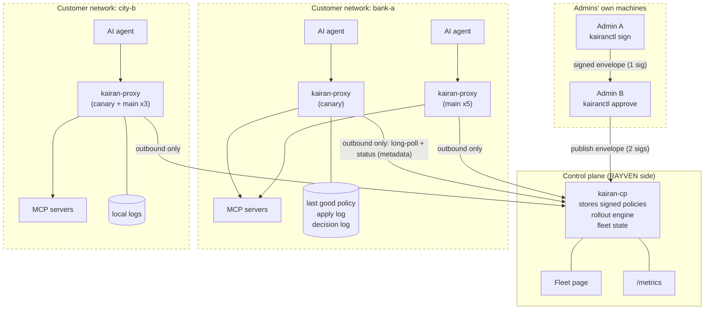
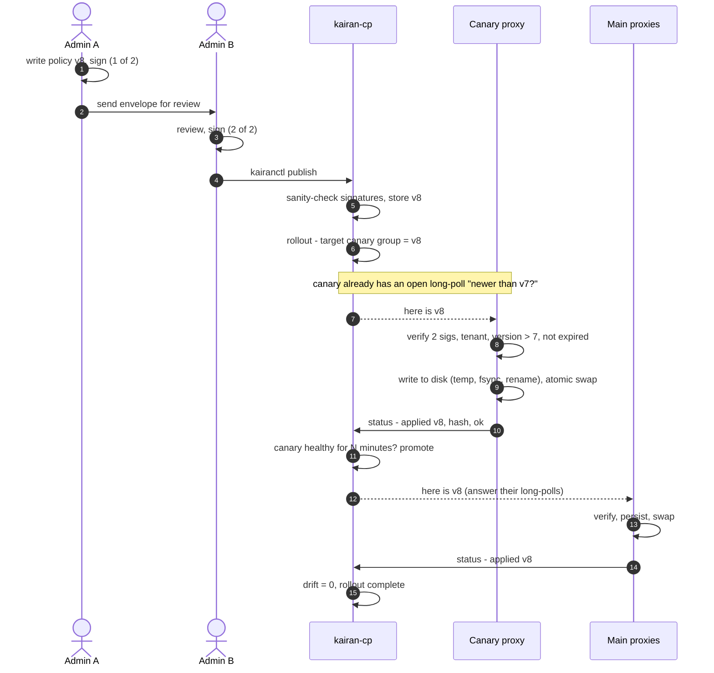
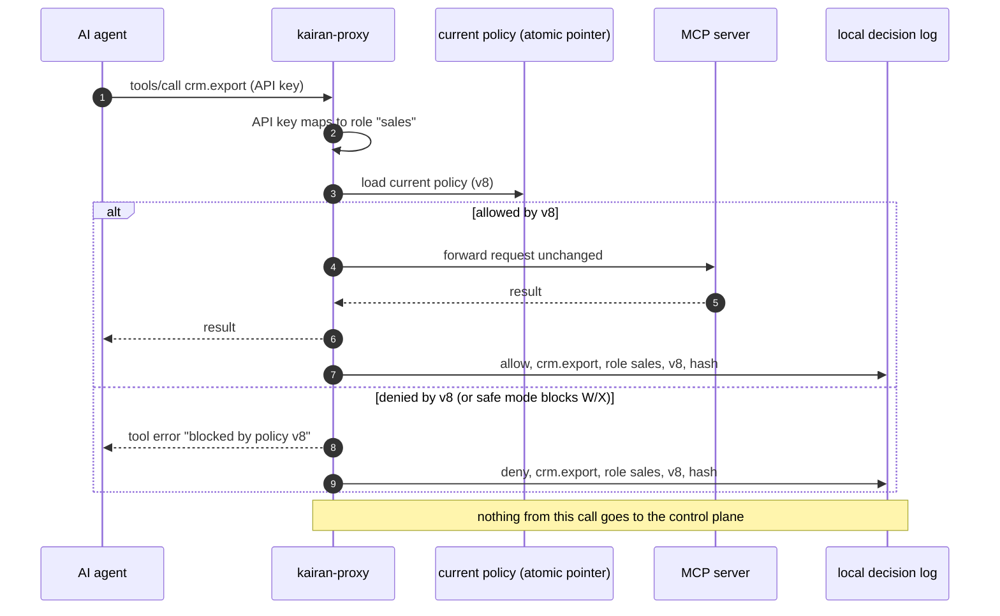
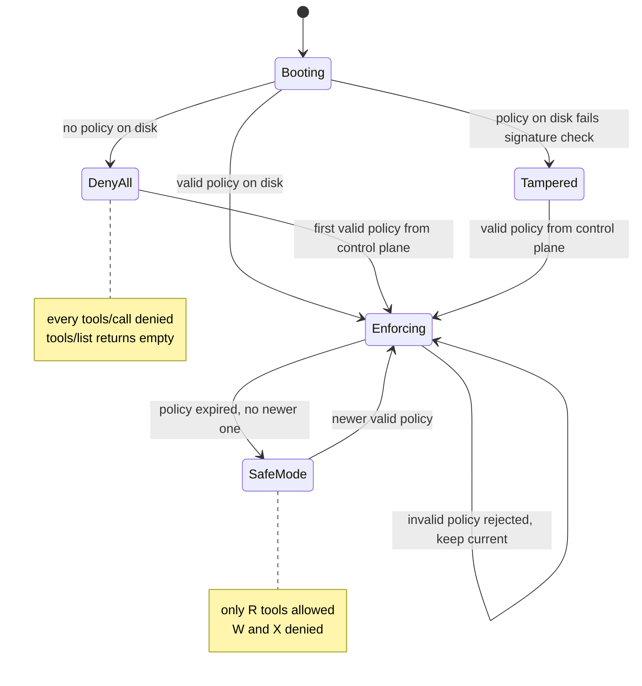
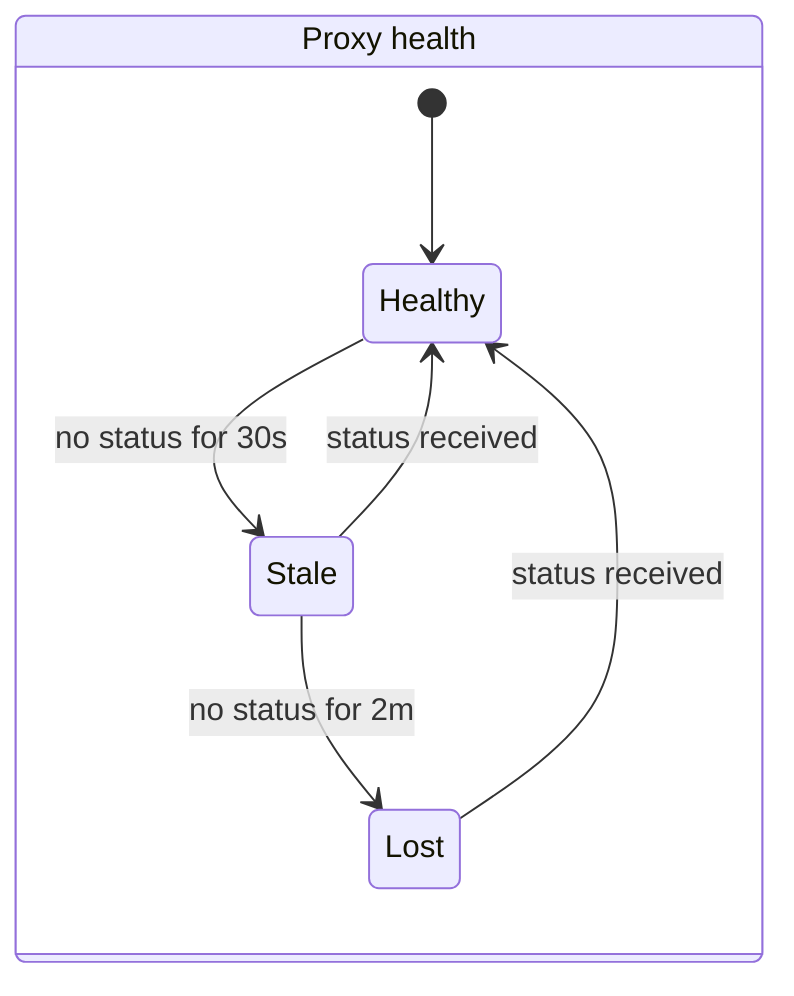
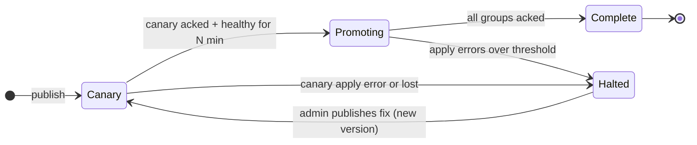
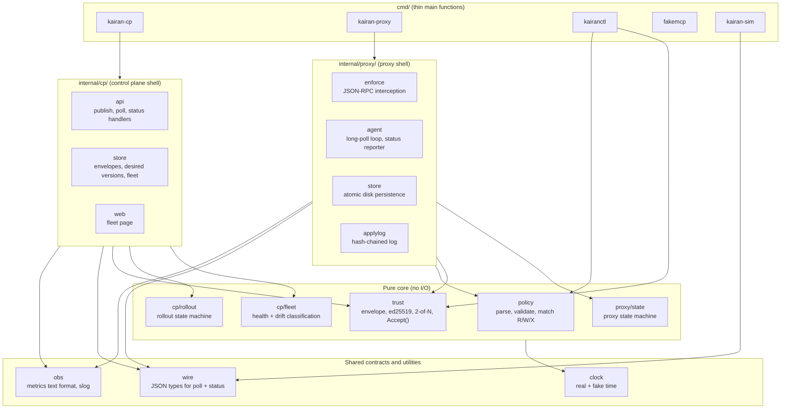
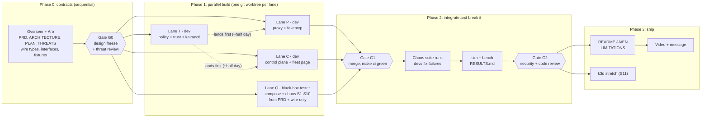

# Kairan: Architecture (HLD + LLD)

Source: `docs/superpowers/specs/2026-11-05-kairan-architecture.md` and `...-design.md`. Order of truth: PRD, then this file, then PLAN, then decisions.jsonl. View diagrams with the VS Code extension `bierner.markdown-mermaid`, or paste into https://mermaid.live.

## 1. System and trust boundaries
Each dashed box is a separate organization's network. **Only metadata crosses a boundary.**



### What may cross a boundary
| From -> To | Allowed | Never |
|---|---|---|
| Admin -> control plane | Signed policy envelopes | Private signing keys |
| Proxy -> control plane | Proxy ID, tenant, applied version, policy hash, state, last error, counters, uptime | Tool arguments, results, prompts, user names, PII |
| Control plane -> proxy | Signed envelopes, "nothing new" (304) | Anything that changes the proxy's trusted keys or threshold |
| Agent <-> proxy <-> MCP server | Everything, but it **stays inside the customer network** | n/a |

## 2. A policy's journey


If the canary fails to apply (step 9), the rollout **halts**, main proxies stay on the old version, and the fleet page shows why.

## 3. One tool call through the proxy


`tools/list` works the same way, except the proxy **removes** tools the role cannot use.

## 4. Proxy states


**Rule behind every arrow:** no transition ever makes permissions wider than the last valid, signed, unexpired policy.

## 5. Control-plane view: health and rollouts




**Drift** = version a proxy *should* have minus the version it *reports*. The fleet page sorts by drift, then health.

## 6. Code structure
**Pure core, thin I/O shell.** Decisions ("accept this envelope?", "is this call allowed?", "is this proxy stale?", "should the rollout promote?") are pure functions taking inputs including the current time. The shell does HTTP, files and timers.



### Dependency rules (enforced by a test that inspects imports; PLAN O-06)
1. `internal/cp/...` and `internal/proxy/...` never import each other. They talk only through `wire` types over HTTP.
2. Core packages (`policy`, `trust`, `cp/fleet`, `cp/rollout`, `proxy/state`) import nothing that does I/O: no `net/http`, no `os`, no real `time.Now()`. Time arrives through `clock`.
3. `wire` is the **frozen contract**. Changing it needs a decision entry and the Overseer's approval.

### Folder layout
```
kairan/
├── AGENTS.md  CLAUDE.md  Makefile  go.mod
├── docs/       PRD.md  ARCHITECTURE.md  PLAN.md  THREATS.md  decisions.jsonl  commits.jsonl
├── cmd/        kairan-cp/ kairan-proxy/ kairanctl/ fakemcp/ kairan-sim/
├── internal/   wire/ clock/ obs/ policy/ trust/
│               cp/{api,store,web,fleet,rollout}/
│               proxy/{enforce,agent,store,applylog,state}/
├── test/       e2e/ (chaos S1-S11)  fixtures/ (TEST-ONLY keys, golden envelopes)
├── bench/      scripts + RESULTS.md generator
├── deploy/     compose/  k8s/ (stretch)
├── scripts/    commit.sh log-decision.sh plan.sh new-lane.sh merge-lane.sh check-jsonl.sh
└── .claude/    settings.json  agents/  hooks/
```

## 7. Phases, lanes, ownership


| Lane | Role · model | May edit | May not |
|---|---|---|---|
| M (Overseer, main session) | Opus 5.5 | `docs/` (PLAN and JSONL only via scripts), `internal/wire/`, `internal/clock/`, `test/fixtures/` (Phase 0), root config, `scripts/`, `.claude/`, `.githooks/` | Lane product code |
| T | Developer · Sonnet 5.5 | `internal/policy/`, `internal/trust/`, `cmd/kairanctl/`, `test/fixtures/` until `.frozen` exists | `wire`, `test/e2e/` |
| P | Developer · Sonnet 5.5 | `internal/proxy/`, `cmd/kairan-proxy/`, `cmd/fakemcp/` | `internal/cp/`, `wire`, `test/e2e/` |
| C | Developer · Sonnet 5.5 | `internal/cp/`, `internal/obs/`, `cmd/kairan-cp/` | `internal/proxy/`, `wire`, `test/e2e/` |
| Q | Black-box tester · Sonnet 5.5 | `test/e2e/`, `deploy/`, `bench/`, `cmd/kairan-sim/` | Read or edit `internal/` and `cmd/` (exception: may read `internal/wire/` and `cmd/kairan-sim/`) |
| R | Security reviewer · Opus 5.5 | nothing (read-only; appends `risk`/`incident` decisions via scripts) | all edits |
| All | n/a | Append to `docs/*.jsonl` only through scripts | Edit or delete existing log lines |

Unit tests live next to the code and belong to the developer lane. e2e tests belong to Q only. If an e2e test is wrong, the developer files an `incident`; they never edit it.

## 8. Failure behavior
| Situation | Behavior |
|---|---|
| Control plane down | Proxies keep enforcing the last good policy. Calls continue. Nothing gets more permissive. |
| Proxy restarts while control plane is down | Loads last good policy from disk, re-verifies it, enforces it. |
| Proxy cut off from the network | Shows stale, then lost. On reconnect it catches up to the latest version. |
| Bad, unsigned, single-signed or wrong-tenant policy | Rejected by every proxy. Old policy stays. Reason reported. |
| Older version offered (replay/rollback) | Rejected. |
| No new policy for too long (expiry passed: freeze attack or long outage) | **Safe mode**: only R (read) tools allowed; W and X blocked. Fleet page and metrics show it loudly. (Configurable; read-only is the default call.) |
| Policy file on disk edited by hand | Signature check fails at load. Proxy refuses it, enters **deny-all** until a valid policy arrives, reports tampering. |
| Disk full or write fails | New policy not applied; old one stays; error reported. |

## 9. Local versus production
| Concern | Local demo | Production (described, not built) |
|---|---|---|
| Control plane | Docker container | Stateless replicas on K3s via Argo CD; Japan region |
| Control-plane storage | JSON files, atomic writes | Postgres; LISTEN/NOTIFY wakes long-polls |
| Proxies | Docker containers | Customer K3s/Kubernetes (Helm or manifests), a VM, or beside Tumiki Desktop |
| Signing keys | Files from kairanctl | Held by people (hardware keys / OS keychain), never on the control plane; rotation and revocation distributed like policies |
| Proxy identity | Enrollment token per proxy | One-time token, then mTLS client cert |
| Admin login | Static admin token | OIDC (Entra ID / Okta / Google) behind Cloudflare Access |
| Control-plane secrets | `.env` | Infisical synced into Kubernetes |
| Network | Docker network | Outbound HTTPS only through the corporate proxy; offline bundle import for closed networks |
| Monitoring | Prometheus + Grafana in Compose | Same metrics scraped by their monitoring; alerts on lost proxies, drift, safe mode |
| Scale | 10 real + simulated | Many tenants; rollouts per tenant and group |

## 10. LLD per package

Each package: responsibility, owner lane, invariants it must uphold, and its interface. **Interfaces are a draft by the Overseer (lane M, 2026-11-05) pending Aro's review at G0** (PLAN O-03, decisions M-D12, M-D13). Signatures are the contract between lanes; names of unexported helpers are the owner's choice. `wire` and `clock` are already code: read the package docs.

### 10.0 Policy payload format (shared by kairanctl, trust, policy, proxy)

The exact bytes inside `wire.Envelope.Payload`. Strict: unknown fields, a missing field, or a value outside these rules is `malformed`.

```json
{
  "tenant": "bank-a",
  "version": 8,
  "issued_at": "2026-11-05T09:00:00Z",
  "expires_at": "2026-11-08T09:00:00Z",
  "default": "deny",
  "roles": {
    "sales":    { "crm.read_*": "R", "crm.update_deal": "W" },
    "engineer": { "github.*": "R", "github.create_issue": "W", "ci.rerun": "X" }
  }
}
```

| Field | Rule |
|---|---|
| `tenant` | `wire.ID` |
| `version` | integer ≥ 1 |
| `issued_at`, `expires_at` | RFC 3339 UTC; `expires_at` > `issued_at`; default validity 72h (kairanctl) |
| `default` | must be `"deny"` |
| `roles` | role name (`wire.ID` pattern) → tool pattern → class `R`, `W` or `X`; ≤ 256 roles, ≤ 1,024 patterns per role |
| tool pattern | exact name, or a prefix ending in a single trailing `*` (`slack.*`, `crm.read_*`). Tool names: 1-128 chars of `[A-Za-z0-9_.-]` |
| matching | exact match wins, else the longest matching prefix; no match = deny. The matched rule's class is the tool's class. Safe mode allows class `R` only |

### `internal/wire` · lane M
- **Responsibility:** JSON contract between control plane, proxy and kairanctl: paths, limits, timing, envelope, poll, status, admin views, error codes.
- **Must uphold:** I4 by construction (status holds only numbers, bools, validated named strings; codes, never text); strict decoding. Changes need a decision entry.
- **Interface:** code in `internal/wire` (draft, PLAN O-02; decisions M-D2 to M-D4).

### `internal/clock` · lane M
- **Responsibility:** Clock interface with a real and a fake implementation.
- **Must uphold:** Core packages never call `time.Now()` directly (arch rule R3).
- **Interface:** code in `internal/clock` (PLAN O-04, M-D1).

### `internal/policy` · lane T · core
- **Responsibility:** Strict parse and validate (§10.0); matcher; safe-mode filter.
- **Must uphold:** I3: unknown input means deny; never panics on garbage (fuzzed). Pure, no I/O.
```go
type Class byte // 'R', 'W', 'X'
type Policy struct {
    Tenant              wire.ID
    Version             uint64
    IssuedAt, ExpiresAt time.Time
    // unexported: compiled roles (exact map + prefixes sorted longest first)
}
func Parse(payload []byte) (*Policy, error)                       // strict §10.0; errors wrap wire.ErrInvalid
type Decision struct { Allowed bool; Class Class; Rule string }  // Rule = matched pattern, "" if none
func (p *Policy) Decide(role, tool string, safeMode bool) Decision
func (p *Policy) Visible(role string, tools []string, safeMode bool) []string // tools/list filter, keeps order
```

### `internal/trust` · lane T · core
- **Responsibility:** DSSE PAE, key IDs, signing helper, 2-of-N verification, accept rules.
- **Must uphold:** I1, I2. Verifies the exact signed bytes. Fuzz the decoder. Pure, no I/O.
```go
type Root struct {                         // from the proxy's local config only
    Tenant    wire.ID
    Keys      map[wire.Hash]ed25519.PublicKey // key ID -> key
    Threshold int                             // 2 in Kairan
}
type Verified struct { Policy *policy.Policy; Hash wire.Hash; Signers []wire.Hash }
func PAE(payloadType string, payload []byte) []byte
func KeyID(pub ed25519.PublicKey) wire.Hash
func Sign(env *wire.Envelope, priv ed25519.PrivateKey)  // appends one signature over PAE
// Verify: shape, payload type, >= Threshold valid signatures from distinct trusted keys, Parse, tenant.
// No version or expiry check (used at boot to re-check the stored envelope).
func Verify(env wire.Envelope, root Root) (Verified, wire.ErrorCode, error)
// Accept: Verify + version > have (I2) + not expired at now (skew tolerated). Used for new envelopes.
func Accept(env wire.Envelope, root Root, have uint64, now time.Time, skew time.Duration) (Verified, wire.ErrorCode, error)
```

### `internal/cp/fleet` · lane C · core
- **Responsibility:** Classify health and compute drift; build the fleet view.
- **Must uphold:** Defaults stale 30s, lost 2m (configurable). Pure, no I/O.
```go
type Thresholds struct { Stale, Lost time.Duration }
type Last struct { Group wire.ID; Report wire.StatusReport; SeenAt time.Time } // SeenAt = CP clock
func Health(seenAt, now time.Time, th Thresholds) wire.Health
// View sorts by drift (desc), then health (lost, stale, healthy), then proxy ID.
func View(tenant wire.ID, desired map[wire.ID]uint64, proxies []Last, now time.Time, th Thresholds) wire.FleetView
```

### `internal/cp/rollout` · lane C · core
- **Responsibility:** Rollout state machine: Canary → Promoting → Complete, or Halted.
- **Must uphold:** Halts on a canary apply error for this version or a lost canary; never lowers a group's desired version. Pure, no I/O.
```go
type Rollout struct {
    Tenant   wire.ID
    Version  uint64
    Previous uint64            // desired version before this rollout
    Phase    wire.RolloutPhase
    Reason   wire.ErrorCode    // set when Halted
    Dwell    time.Duration     // canary must stay healthy this long
    CanaryOK time.Time         // when every canary proxy first acked Version; zero until then
}
func Start(req wire.RolloutRequest, previous uint64, now time.Time, defaultDwell time.Duration) Rollout
// Step returns the next state and the desired version for every group in the fleet view.
func Step(r Rollout, fleet wire.FleetView, now time.Time) (Rollout, map[wire.ID]uint64)
const CanaryGroup wire.ID = "canary"
```

### `internal/cp/store` · lane C
- **Responsibility:** JSON-file storage: envelopes, rollouts, last status per proxy, timeline.
- **Must uphold:** Atomic writes (temp, fsync, rename). Never stores payload beyond the signed envelope. Safe for concurrent use.
```go
type Store interface {
    PutEnvelope(env wire.Envelope, v trust.Verified) error  // wire.ErrConflict if the version exists
    Envelope(tenant wire.ID, version uint64) (wire.Envelope, error)
    PutRollout(r rollout.Rollout) error
    Rollout(tenant wire.ID) (rollout.Rollout, bool, error)
    RecordStatus(l fleet.Last) error                         // updates last status and the timeline
    Fleet(tenant wire.ID) ([]fleet.Last, error)
    Timeline(tenant wire.ID) ([]wire.TimelineEntry, error)
}
func OpenFiles(dir string) (Store, error)
```

### `internal/cp/api` · lane C
- **Responsibility:** HTTP handlers for every path in `wire`; long-poll wake-ups; rollout ticking.
- **Must uphold:** I4; strict decoding with wire limits; timeouts and caps from M-D9; tokens compared with `crypto/subtle`; publish checks signatures against the tenant's admin keys (sanity only; proxies are the judges).
```go
type Enrollment struct { Tenant, Group wire.ID; Token string }   // registry: proxy ID -> enrollment
type Config struct {
    AdminToken   string
    Proxies      map[wire.ID]Enrollment
    AdminKeys    map[wire.ID]trust.Root   // per tenant, for the publish sanity check
    PollHold     time.Duration            // default wire.PollHold
    MaxPolls     int                      // default 5000
    CanaryDwell  time.Duration
    Thresholds   fleet.Thresholds
}
func New(cfg Config, st store.Store, clk clock.Clock, log *slog.Logger, m *obs.Registry) *Server
func (s *Server) Handler() http.Handler
func (s *Server) HTTPServer(addr string) *http.Server  // timeouts per M-D9
```

### `internal/cp/web` · lane C
- **Responsibility:** Fleet page in Japanese and English (`html/template` + `embed`), auto-refresh.
- **Must uphold:** Metadata only; all output escaped; JST and UTC times.
```go
func Handler(st store.Store, clk clock.Clock, th fleet.Thresholds) http.Handler // GET /?tenant=&lang=ja|en
```

### `internal/obs` · lane C
- **Responsibility:** Hand-written Prometheus text format; slog setup.
- **Must uphold:** I4: label values are `wire.ID`s only, so call data can't become a label.
```go
type Registry struct{ /* ... */ }
func NewRegistry() *Registry
func (r *Registry) Counter(name, help string, labelNames ...string) *Counter
func (r *Registry) Gauge(name, help string, labelNames ...string) *Gauge
func (c *Counter) With(labelValues ...wire.ID) *CounterValue   // Inc, Add(uint64)
func (g *Gauge) With(labelValues ...wire.ID) *GaugeValue       // Set(float64)
func (r *Registry) Handler() http.Handler                       // text/plain; version=0.0.4
func NewLogger(w io.Writer, level slog.Level) *slog.Logger      // JSON, UTC
```

### `internal/proxy/state` · lane P · core
- **Responsibility:** Proxy state machine (Booting, DenyAll, Tampered, Enforcing, SafeMode) and what each state allows.
- **Must uphold:** I3: no transition widens permissions beyond the last valid, signed, unexpired policy. Pure, no I/O.
```go
type Event int
const (
    BootNoPolicy Event = iota // nothing on disk
    BootTampered              // stored envelope failed Verify
    BootValid                 // stored envelope verified, not expired
    BootExpired               // stored envelope verified, expired
    Applied                   // new envelope accepted and persisted
    Rejected                  // new envelope rejected (state unchanged)
    Expired                   // expiry passed with no newer policy
    ClockUntrusted            // M-D8, if accepted
)
func Next(s wire.ProxyState, e Event) wire.ProxyState
func Allows(s wire.ProxyState, d policy.Decision) bool // Enforcing: d.Allowed; SafeMode: d.Allowed && d.Class=='R'; else false
```

### `internal/proxy/enforce` · lane P
- **Responsibility:** JSON-RPC interception of `tools/list` and `tools/call`; pass-through for everything else; API key → role; local decision log.
- **Must uphold:** I3, I5: every decision carries policy version + hash; in-flight calls finish under the policy they started with. Timeouts and body limits.
```go
type Active struct { Policy *policy.Policy; Hash wire.Hash; State wire.ProxyState }
type Holder struct{ /* atomic.Pointer[Active] */ }
func (h *Holder) Load() *Active
func (h *Holder) Store(a *Active)
type Record struct { Time time.Time; Role, Tool string; Allowed bool; Class policy.Class; Version uint64; Hash wire.Hash; State wire.ProxyState }
type DecisionLog interface { Record(Record) error }     // local JSONL file in production
type Config struct { Upstream *url.URL; APIKeys map[string]string /* key -> role */ }
func New(cfg Config, h *Holder, dl DecisionLog, clk clock.Clock, m *obs.Registry) http.Handler
```

### `internal/proxy/store` · lane P
- **Responsibility:** Atomic persistence of the last good envelope.
- **Must uphold:** I3: a stored file that fails verification is never enforced (caller goes Tampered). Temp, fsync, rename; fsync the directory.
```go
func Open(dir string) (*Store, error)
func (s *Store) Save(env wire.Envelope) error
func (s *Store) Load() (env wire.Envelope, found bool, err error)
```

### `internal/proxy/applylog` · lane P
- **Responsibility:** Append-only, hash-chained log of apply attempts; verifier.
- **Must uphold:** I6: edit, delete or reorder is detected. Also the source of the highest applied version across restarts (I2).
```go
type Entry struct {
    Seq     uint64
    Time    time.Time
    From    uint64          // version before
    To      uint64          // version offered
    Hash    wire.Hash       // payload hash offered
    Result  wire.ErrorCode  // "" = applied
    Prev    wire.Hash       // hash of the previous entry ("" for the first)
    Self    wire.Hash       // SHA-256 over this entry's canonical fields + Prev
}
func Open(path string) (*Log, error)                      // verifies the existing chain first
func (l *Log) Append(e Entry) (Entry, error)              // fills Seq, Prev, Self
func (l *Log) LastApplied() (version uint64, hash wire.Hash)
func Verify(r io.Reader) (last Entry, n int, err error)   // used by kairanctl too
```

### `internal/proxy/agent` · lane P
- **Responsibility:** Boot, long-poll loop, status loop (immediate after apply, else every 10s), backoff, outbound only, honors `HTTPS_PROXY`.
- **Must uphold:** I1, I2, I4: verify via `trust`, version must beat the apply log, metadata-only reports, failures keep the current policy.
```go
type Config struct {
    CP      *url.URL
    Tenant  wire.ID
    ProxyID wire.ID
    Token   string
    Root    trust.Root
    Skew    time.Duration
}
func New(cfg Config, st *store.Store, al *applylog.Log, h *enforce.Holder, clk clock.Clock, hc *http.Client, log *slog.Logger, m *obs.Registry) *Agent
func (a *Agent) Boot() error                      // load, Verify, compare with apply log, set Holder + state
func (a *Agent) Run(ctx context.Context) error    // poll + status loops until ctx is done
```

### `cmd/kairan-cp` · lane C
- **Responsibility:** Thin main: flags `-config cp.json -data DIR -addr :8080`; wiring; graceful shutdown on SIGTERM.
- **Must uphold:** No logic.

### `cmd/kairan-proxy` · lane P
- **Responsibility:** Thin main: `-config proxy.json` holding `tenant`, `proxy_id`, `cp_url`, `token`, `trusted_keys` (hex public keys), `threshold`, `listen`, `upstream`, `api_keys` (key → role), `data_dir`.
- **Must uphold:** Trust root only from local config.

### `cmd/kairanctl` · lane T
- **Responsibility:** `keygen`, `policy new`, `sign`, `approve`, `publish`, `rollout start|status`, `fleet`, `evidence`, `verify-applylog`.
- **Must uphold:** Private keys never leave the admin's machine; `approve` refuses to add a second signature from the same key.

### `cmd/fakemcp` · lane P
- **Responsibility:** Tiny MCP server over Streamable HTTP with harmless tools: `notes.read` (R), `notes.write` (W), `crm.read_contact` (R), `crm.export` (X). Echoes nothing secret.
- **Must uphold:** Test and demo only.

### `cmd/kairan-sim` · lane Q
- **Responsibility:** `-cp URL -n 1000 -tenant sim` runs N simulated proxies (real HTTP long-poll + status, same timing as `wire`), prints JSON results.
- **Must uphold:** Always labeled simulated; uses only `wire` (black-box).
