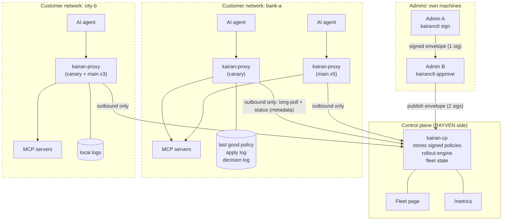
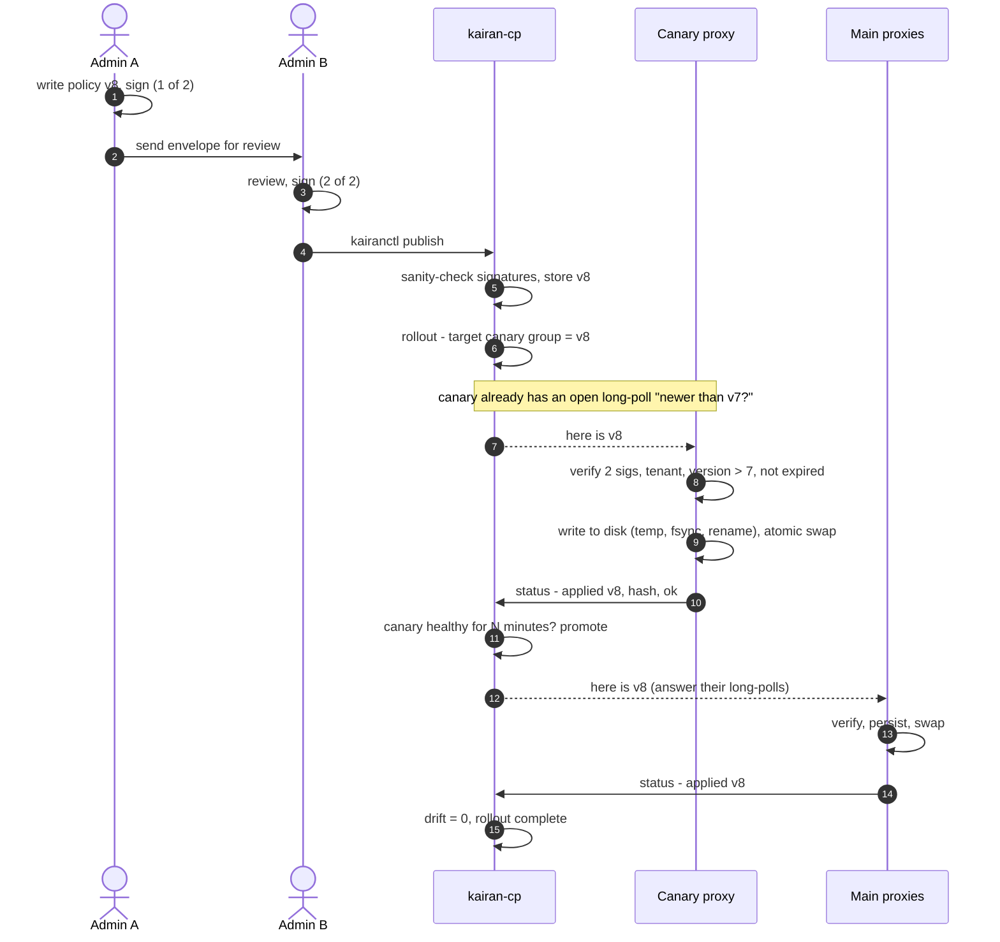
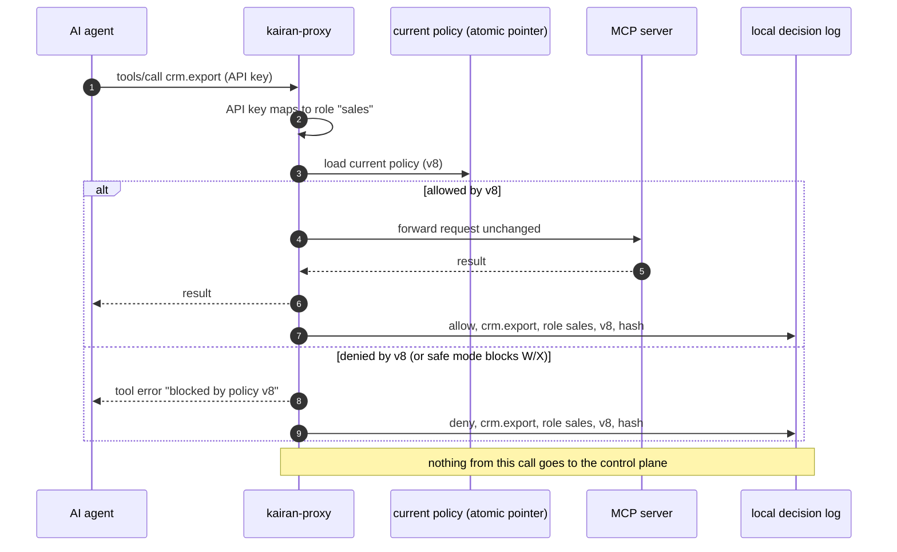
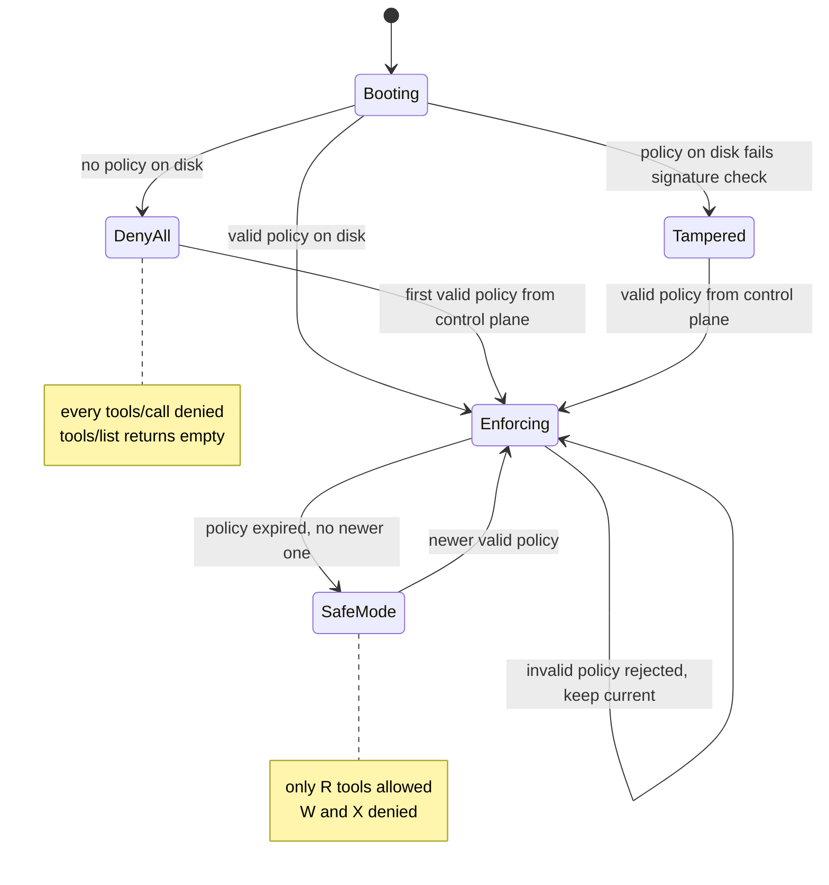
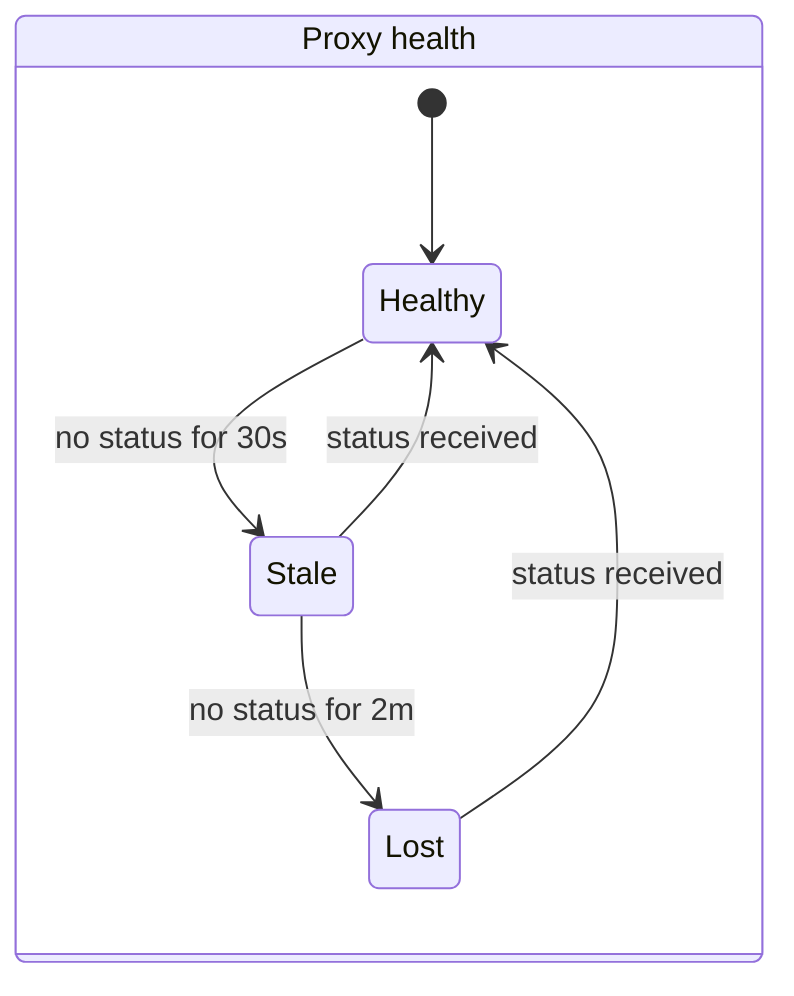
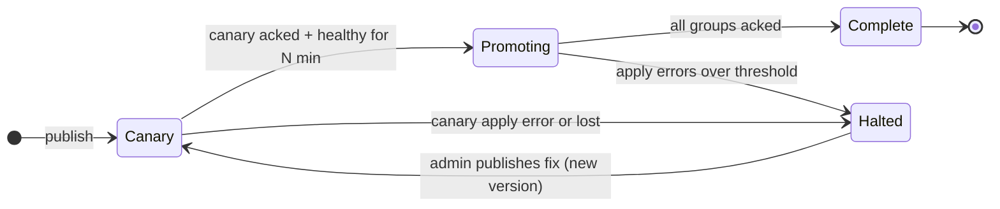
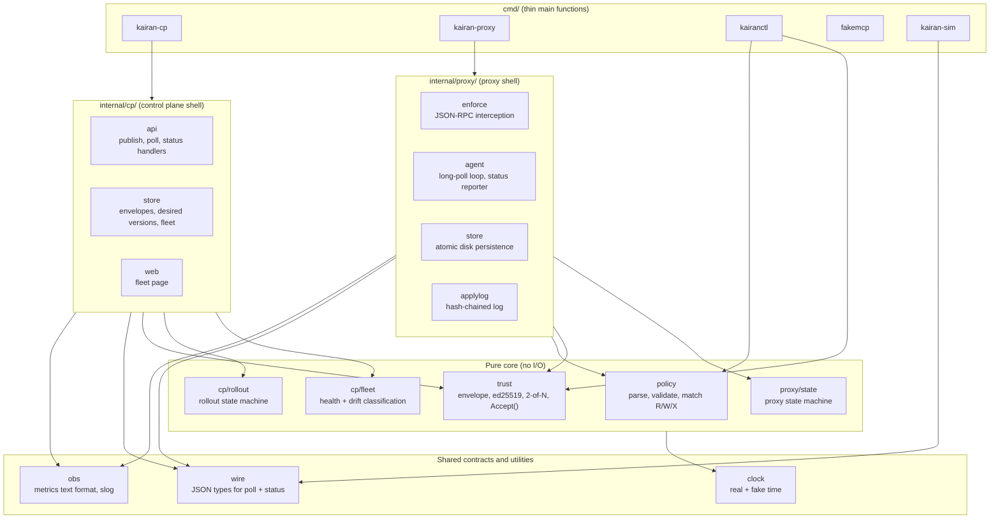
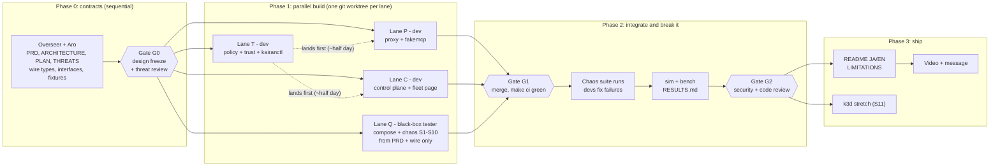

# Kairan: Architecture (HLD + LLD)

Source: `docs/superpowers/specs/2026-11-05-kairan-architecture.md` and `...-design.md`. Order of truth: PRD, then this file, then PLAN, then decisions.jsonl. View diagrams with the VS Code extension `bierner.markdown-mermaid`, or paste into https://mermaid.live.

## 1. System and trust boundaries
Each dashed box is a separate organization's network. **Only metadata crosses a boundary.**



### What may cross a boundary
| From -> To | Allowed | Never |
|---|---|---|
| Admin -> control plane | Signed policy envelopes | Private signing keys |
| Proxy -> control plane | Proxy ID, tenant, applied version, policy hash, state, last error, counters, uptime | Tool arguments, results, prompts, user names, PII |
| Control plane -> proxy | Signed envelopes, "nothing new" (304) | Anything that changes the proxy's trusted keys or threshold |
| Agent <-> proxy <-> MCP server | Everything, but it **stays inside the customer network** | n/a |

## 2. A policy's journey


If the canary fails to apply (step 9), the rollout **halts**, main proxies stay on the old version, and the fleet page shows why.

## 3. One tool call through the proxy


`tools/list` works the same way, except the proxy **removes** tools the role cannot use.

## 4. Proxy states


**Rule behind every arrow:** no transition ever makes permissions wider than the last valid, signed, unexpired policy.

## 5. Control-plane view: health and rollouts




**Drift** = version a proxy *should* have minus the version it *reports*. The fleet page sorts by drift, then health.

## 6. Code structure
**Pure core, thin I/O shell.** Decisions ("accept this envelope?", "is this call allowed?", "is this proxy stale?", "should the rollout promote?") are pure functions taking inputs including the current time. The shell does HTTP, files and timers.



### Dependency rules (enforced by a test that inspects imports; PLAN O-06)
1. `internal/cp/...` and `internal/proxy/...` never import each other. They talk only through `wire` types over HTTP.
2. Core packages (`policy`, `trust`, `cp/fleet`, `cp/rollout`, `proxy/state`) import nothing that does I/O: no `net/http`, no `os`, no real `time.Now()`. Time arrives through `clock`.
3. `wire` is the **frozen contract**. Changing it needs a decision entry and the Overseer's approval.

### Folder layout
```
kairan/
├── AGENTS.md  CLAUDE.md  Makefile  go.mod
├── docs/       PRD.md  ARCHITECTURE.md  PLAN.md  THREATS.md  decisions.jsonl  commits.jsonl
├── cmd/        kairan-cp/ kairan-proxy/ kairanctl/ fakemcp/ kairan-sim/
├── internal/   wire/ clock/ obs/ policy/ trust/
│               cp/{api,store,web,fleet,rollout}/
│               proxy/{enforce,agent,store,applylog,state}/
├── test/       e2e/ (chaos S1-S11)  fixtures/ (TEST-ONLY keys, golden envelopes)
├── bench/      scripts + RESULTS.md generator
├── deploy/     compose/  k8s/ (stretch)
├── scripts/    commit.sh log-decision.sh plan.sh new-lane.sh merge-lane.sh check-jsonl.sh
└── .claude/    settings.json  agents/  hooks/
```

## 7. Phases, lanes, ownership


| Lane | Role · model | May edit | May not |
|---|---|---|---|
| M (Overseer, main session) | Opus 5.5 | `docs/` (PLAN and JSONL only via scripts), `internal/wire/`, `internal/clock/`, `test/fixtures/` (Phase 0), root config, `scripts/`, `.claude/`, `.githooks/` | Lane product code |
| T | Developer · Sonnet 5.5 | `internal/policy/`, `internal/trust/`, `cmd/kairanctl/`, `test/fixtures/` until `.frozen` exists | `wire`, `test/e2e/` |
| P | Developer · Sonnet 5.5 | `internal/proxy/`, `cmd/kairan-proxy/`, `cmd/fakemcp/` | `internal/cp/`, `wire`, `test/e2e/` |
| C | Developer · Sonnet 5.5 | `internal/cp/`, `internal/obs/`, `cmd/kairan-cp/` | `internal/proxy/`, `wire`, `test/e2e/` |
| Q | Black-box tester · Sonnet 5.5 | `test/e2e/`, `deploy/`, `bench/`, `cmd/kairan-sim/` | Read or edit `internal/` and `cmd/` (exception: may read `internal/wire/` and `cmd/kairan-sim/`) |
| R | Security reviewer · Opus 5.5 | nothing (read-only; appends `risk`/`incident` decisions via scripts) | all edits |
| All | n/a | Append to `docs/*.jsonl` only through scripts | Edit or delete existing log lines |

Unit tests live next to the code and belong to the developer lane. e2e tests belong to Q only. If an e2e test is wrong, the developer files an `incident`; they never edit it.

## 8. Failure behavior
| Situation | Behavior |
|---|---|
| Control plane down | Proxies keep enforcing the last good policy. Calls continue. Nothing gets more permissive. |
| Proxy restarts while control plane is down | Loads last good policy from disk, re-verifies it, enforces it. |
| Proxy cut off from the network | Shows stale, then lost. On reconnect it catches up to the latest version. |
| Bad, unsigned, single-signed or wrong-tenant policy | Rejected by every proxy. Old policy stays. Reason reported. |
| Older version offered (replay/rollback) | Rejected. |
| No new policy for too long (expiry passed: freeze attack or long outage) | **Safe mode**: only R (read) tools allowed; W and X blocked. Fleet page and metrics show it loudly. (Configurable; read-only is the default call.) |
| Policy file on disk edited by hand | Signature check fails at load. Proxy refuses it, enters **deny-all** until a valid policy arrives, reports tampering. |
| Disk full or write fails | New policy not applied; old one stays; error reported. |

## 9. Local versus production
| Concern | Local demo | Production (described, not built) |
|---|---|---|
| Control plane | Docker container | Stateless replicas on K3s via Argo CD; Japan region |
| Control-plane storage | JSON files, atomic writes | Postgres; LISTEN/NOTIFY wakes long-polls |
| Proxies | Docker containers | Customer K3s/Kubernetes (Helm or manifests), a VM, or beside Tumiki Desktop |
| Signing keys | Files from kairanctl | Held by people (hardware keys / OS keychain), never on the control plane; rotation and revocation distributed like policies |
| Proxy identity | Enrollment token per proxy | One-time token, then mTLS client cert |
| Admin login | Static admin token | OIDC (Entra ID / Okta / Google) behind Cloudflare Access |
| Control-plane secrets | `.env` | Infisical synced into Kubernetes |
| Network | Docker network | Outbound HTTPS only through the corporate proxy; offline bundle import for closed networks |
| Monitoring | Prometheus + Grafana in Compose | Same metrics scraped by their monitoring; alerts on lost proxies, drift, safe mode |
| Scale | 10 real + simulated | Many tenants; rollouts per tenant and group |

## 10. LLD per package
Each package: responsibility, owner lane, invariants it must uphold. Interfaces are written in Phase 0 (PLAN O-03); until then the placeholder stays.

### `internal/wire` · lane M
- **Responsibility:** JSON types shared by control plane and proxy: poll request/response, status report, error codes. The frozen contract. No logic.
- **Must uphold:** I4: the status type has no field that can carry payload; decoders reject unknown fields. Changes need a decision entry.
- **Interface:** TODO(Phase 0): interface

### `internal/clock` · lane M
- **Responsibility:** Clock interface with a real and a fake implementation; the only source of time for core packages.
- **Must uphold:** Core packages never call time.Now() directly.
- **Interface:** TODO(Phase 0): interface

### `internal/obs` · lane C
- **Responsibility:** Hand-written Prometheus text format, slog setup.
- **Must uphold:** I4: no tool arguments, results or user data in labels or log fields.
- **Interface:** TODO(Phase 0): interface

### `internal/policy` · lane T
- **Responsibility:** Strict parse and validate; matcher (role -> tool -> R/W/X, wildcards, default deny); safe-mode filter (R only).
- **Must uphold:** I3: unknown input means deny; never panics on garbage (fuzzed). Pure, no I/O.
- **Interface:** TODO(Phase 0): interface

### `internal/trust` · lane T
- **Responsibility:** Envelope over exact bytes, ed25519 verify, 2-of-N distinct trusted keys, Accept(envelope, state, now) with tenant, version and expiry (small skew) checks.
- **Must uphold:** I1, I2. Verifies the exact signed bytes. Fuzz the decoder. Pure, no I/O.
- **Interface:** TODO(Phase 0): interface

### `internal/cp/api` · lane C
- **Responsibility:** HTTP handlers: publish, long-poll, status, admin. Sanity-checks signatures but is not the final judge.
- **Must uphold:** I4: strict JSON decode, reject unknown fields. Server timeouts, MaxBytesReader on every body. Constant-time token compare.
- **Interface:** TODO(Phase 0): interface

### `internal/cp/store` · lane C
- **Responsibility:** JSON-file storage: envelopes, desired version per group, fleet state and timeline.
- **Must uphold:** Atomic writes (temp, fsync, rename). Never stores payload.
- **Interface:** TODO(Phase 0): interface

### `internal/cp/web` · lane C
- **Responsibility:** Fleet page in Japanese and English (html/template + embed). Sorted by drift, then health.
- **Must uphold:** Shows metadata only; escapes all output.
- **Interface:** TODO(Phase 0): interface

### `internal/cp/fleet` · lane C
- **Responsibility:** Pure: classify proxies healthy/stale/lost and compute drift from last status and now.
- **Must uphold:** Thresholds configurable (default stale 30s, lost 2m). Pure, no I/O.
- **Interface:** TODO(Phase 0): interface

### `internal/cp/rollout` · lane C
- **Responsibility:** Pure rollout state machine: Canary, Promoting, Halted, Complete.
- **Must uphold:** Halts on canary apply error or loss; rollback is a new higher version. Pure, no I/O.
- **Interface:** TODO(Phase 0): interface

### `internal/proxy/enforce` · lane P
- **Responsibility:** JSON-RPC interception of tools/list and tools/call; atomic policy pointer; API key to role; pass-through for everything else; local decision log.
- **Must uphold:** I3, I5: every decision carries policy version + hash; in-flight calls finish under the old policy. Server timeouts, body limits.
- **Interface:** TODO(Phase 0): interface

### `internal/proxy/agent` · lane P
- **Responsibility:** Long-poll loop, verify via trust.Accept, persist, swap, ack; status reporter (~10s); honors HTTPS_PROXY; outbound only.
- **Must uphold:** I1, I2, I4: reports metadata only; failures keep the current policy.
- **Interface:** TODO(Phase 0): interface

### `internal/proxy/store` · lane P
- **Responsibility:** Atomic persistence of the last good envelope; reload and re-verify at boot.
- **Must uphold:** I3: a file failing verification means Tampered/deny-all, never enforced. Atomic writes.
- **Interface:** TODO(Phase 0): interface

### `internal/proxy/applylog` · lane P
- **Responsibility:** Append-only apply log with prev-hash chain; verifier.
- **Must uphold:** I6: edit, delete or reorder is detected.
- **Interface:** TODO(Phase 0): interface

### `internal/proxy/state` · lane P
- **Responsibility:** Pure proxy state machine (Booting, DenyAll, Tampered, Enforcing, SafeMode).
- **Must uphold:** I3: no transition widens permissions beyond the last valid, signed, unexpired policy. Pure, no I/O.
- **Interface:** TODO(Phase 0): interface

### `cmd/kairan-cp` · lane C
- **Responsibility:** Thin main for the control plane: config, wiring, graceful shutdown.
- **Must uphold:** No logic.
- **Interface:** TODO(Phase 0): interface

### `cmd/kairan-proxy` · lane P
- **Responsibility:** Thin main for the proxy: local config (tenant, trusted keys, threshold), wiring.
- **Must uphold:** Trust root only from local config.
- **Interface:** TODO(Phase 0): interface

### `cmd/kairanctl` · lane T
- **Responsibility:** Admin CLI: keygen, policy new, sign, approve, publish, rollout/rollback, evidence export, apply-log verify.
- **Must uphold:** Private keys never leave the admin's machine.
- **Interface:** TODO(Phase 0): interface

### `cmd/fakemcp` · lane P
- **Responsibility:** Tiny MCP server with harmless read-like and write-like tools.
- **Must uphold:** Test and demo only.
- **Interface:** TODO(Phase 0): interface

### `cmd/kairan-sim` · lane Q
- **Responsibility:** Runs many simulated proxies in one process; each really long-polls and reports over HTTP.
- **Must uphold:** Always labeled simulated in results.
- **Interface:** TODO(Phase 0): interface

