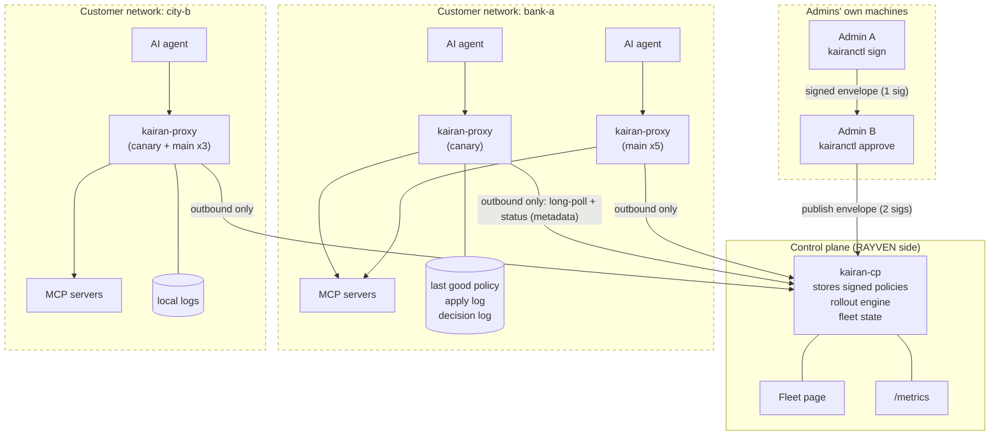
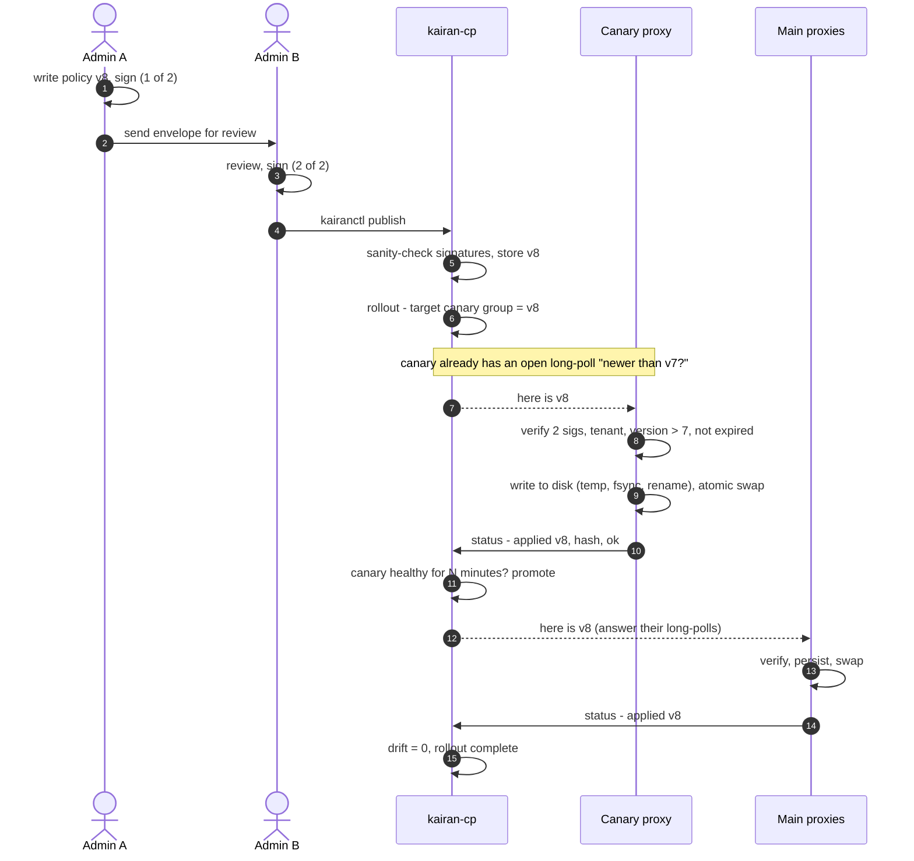
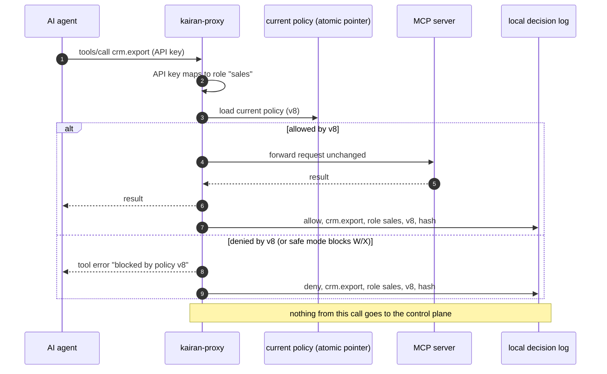
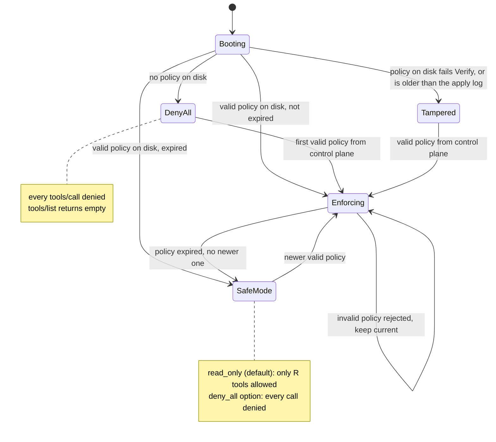
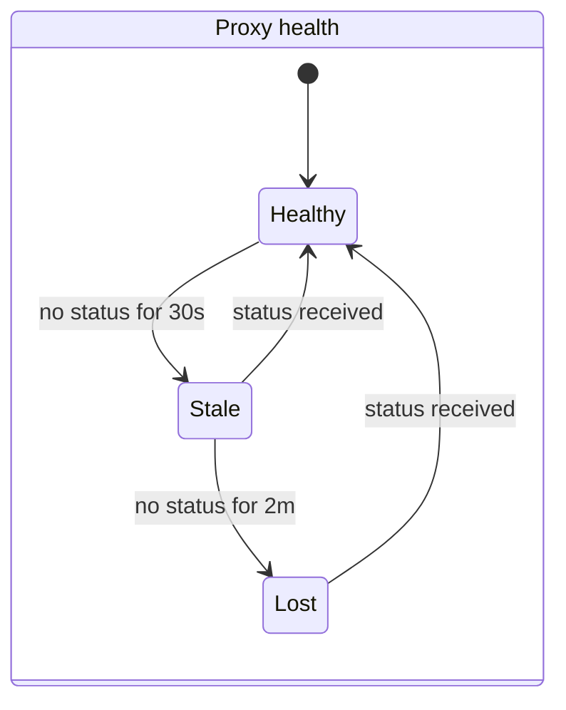
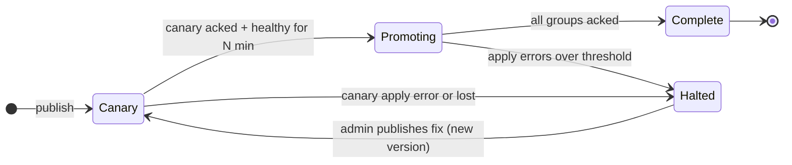
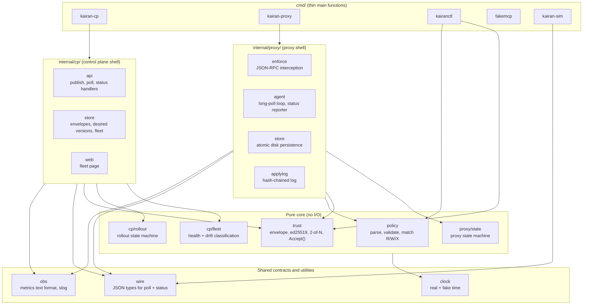
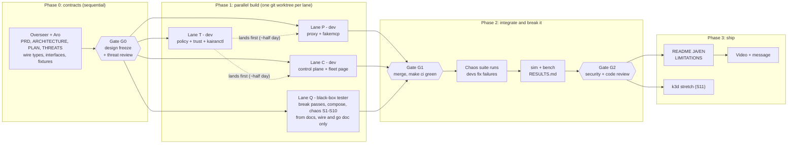

# Kairan: Architecture (HLD + LLD)

Source: Aro's approved design of 2026-11-05 (not in this repository). The PRD, then this file, is the top source of truth. Order of truth: PRD, then this file, then PLAN, then decisions.jsonl. View diagrams with the VS Code extension `bierner.markdown-mermaid`, or paste into https://mermaid.live.

## 1. System and trust boundaries
Each dashed box is a separate organization's network. **Only metadata crosses a boundary.**



### What may cross a boundary
| From -> To | Allowed | Never |
|---|---|---|
| Admin -> control plane | Signed policy envelopes, rollout requests, admin token | Private signing keys |
| Control plane -> admin (kairanctl) | Fleet view, rollout view, timeline, stored signed envelopes: metadata only | Call data (the control plane never has it) |
| Proxy -> control plane | Proxy ID, tenant, applied version, policy hash, state, last error, counters, uptime, apply-log seq and head (M-D35) | Tool arguments, results, prompts, user names, PII |
| Control plane -> proxy | Signed envelopes, "nothing new" (304) | Anything that changes the proxy's trusted keys or threshold |
| Offline bundle file -> proxy (J3, P-11) | A signed envelope, checked by the same `trust.Accept`, Save then Append, as one from the control plane | A way around signature, version or expiry checks; trusted keys or threshold |
| Prometheus -> control plane and proxy (metrics scrape) | Counters and gauges; label values are `wire.ID` only, so no hash or call data can be a label (M-D29). Proxy metrics are served on its local listener and scraped inside the customer network | Tool arguments, results, prompts, PII. In the compose demo one Prometheus scrapes all tenant networks; that is a demo shortcut |
| Proxy apply log -> admin (kairanctl evidence, T-07) | Apply-log entries (seq, versions, hashes, result codes), read inside the customer network and compared with the CP timeline | Decision-log call data sent to the control plane |
| Proxy -> corporate `HTTPS_PROXY` -> control plane | The same bytes as Proxy -> control plane, inside TLS (CONNECT). A TLS-inspecting corporate proxy sees that metadata and the enrollment token; its CA goes in `ca_file` (M-D31) | Anything not allowed for Proxy -> control plane; `InsecureSkipVerify` |
| Agent <-> proxy <-> MCP server | Everything, including the agent's API key on the agent -> proxy hop, but it **stays inside the customer network** | n/a |

## 2. A policy's journey


If the canary fails to apply (step 9), the rollout **halts**, main proxies stay on the old version, and the fleet page shows why.

## 3. One tool call through the proxy


`tools/list` works the same way, except the proxy **removes** tools the role cannot use.

## 4. Proxy states


**Rule behind every arrow:** no transition ever makes permissions wider than the last valid, signed, unexpired policy.

**Boot rule (M-D33).** The stored envelope is re-checked with `trust.Verify` and compared with the apply log's last applied version. Stored version lower than the log: Tampered. Stored version higher than the log and Verify passes: accept it and append a repair entry (a crash between Save and Append). On every apply the order is Save, then Append. "Expired" always means expired at `effective_now` (M-D30, section 10 `proxy/agent`). An untrusted clock is reported (`clock_untrusted`) but is not a state of its own.

## 5. Control-plane view: health and rollouts




**Drift** = version a proxy *should* have minus the version it *reports*. The fleet page sorts by drift, then health.

## 6. Code structure
**Pure core, thin I/O shell.** Decisions ("accept this envelope?", "is this call allowed?", "is this proxy stale?", "should the rollout promote?") are pure functions taking inputs including the current time. The shell does HTTP, files and timers.



### Dependency rules R1-R6 (enforced by `arch_test.go` on every `make ci`; PLAN O-06, M-D5)
- **R1** `internal/cp/...` and `internal/proxy/...` never import each other. They talk only through `wire` types over HTTP.
- **R2** Core packages (`policy`, `trust`, `cp/fleet`, `cp/rollout`, `proxy/state`) do no I/O: no `net`, `os`, files, logging or shell packages.
- **R3** Core packages never read the clock directly (`time.Now`, `time.Since`, `time.Sleep`, `time.After` and the like). Time arrives through `clock` or as an argument.
- **R4** `internal/wire` and `internal/clock` import no kairan package.
- **R5** Nothing imports `kairan/cmd/...`.
- **R6** Standard library only.

Test files are exempt from R2 and R3 only. Separately, `wire` is the **frozen contract**: changing it needs a decision entry and the Overseer's approval.

### Folder layout
```
kairan/
├── AGENTS.md  CLAUDE.md  Makefile  go.mod  arch_test.go (R1-R6)
├── docs/       PRD.md  ARCHITECTURE.md  PLAN.md  THREATS.md  decisions.jsonl  commits.jsonl
├── cmd/        kairan-cp/ kairan-proxy/ kairanctl/ fakemcp/ kairan-sim/
├── internal/   wire/ clock/ obs/ policy/ trust/
│               cp/{api,store,web,fleet,rollout}/
│               proxy/{enforce,agent,store,applylog,state}/
├── test/       e2e/ (chaos S1-S11)  break/<pkg>/ (break-pass attack tests, M-D17)
│               fixtures/ (TEST-ONLY keys, golden envelopes)
├── bench/      scripts + RESULTS.md generator
├── deploy/     compose/  k8s/ (stretch)
├── scripts/    commit.sh log-decision.sh plan.sh new-lane.sh merge-lane.sh sync-lane.sh check-jsonl.sh
├── .githooks/  pre-commit
└── .claude/    settings.json  agents/  hooks/
```

## 7. Phases, lanes, ownership


| Lane | Role · model | May edit | May not |
|---|---|---|---|
| M (Overseer, main session) | Opus 5.5 | `docs/` (PLAN and JSONL only via scripts), `internal/wire/`, `internal/clock/`, `test/fixtures/` (Phase 0), root config, `scripts/`, `.claude/`, `.githooks/` | Lane product code |
| T | Developer · Sonnet 5.5 | `internal/policy/`, `internal/trust/`, `cmd/kairanctl/`, `test/fixtures/` until `.frozen` exists | `wire`, `test/e2e/` |
| P | Developer · Sonnet 5.5 | `internal/proxy/`, `cmd/kairan-proxy/`, `cmd/fakemcp/` | `internal/cp/`, `wire`, `test/e2e/` |
| C | Developer · Sonnet 5.5 | `internal/cp/`, `internal/obs/`, `cmd/kairan-cp/` | `internal/proxy/`, `wire`, `test/e2e/` |
| Q | Black-box tester · Sonnet 5.5 | `test/e2e/`, `test/break/`, `deploy/`, `bench/`, `cmd/kairan-sim/` | Read or edit `internal/` and `cmd/` (exceptions: may read `internal/wire/`, `test/fixtures/` and `cmd/kairan-sim/`; sees other packages' exported API through `go doc` only, never `-src`; M-D17) |
| R | Security reviewer · Opus 5.5 | nothing (read-only; appends `risk`/`incident` decisions via scripts) | all edits |
| All | n/a | Append to `docs/*.jsonl` only through scripts | Edit or delete existing log lines |

Unit tests live next to the code and belong to the developer lane. e2e and break tests (`test/e2e/`, `test/break/`) belong to Q only. If one is wrong, the developer files an `incident`; they never edit it. A task is `done` only after a break pass: Q attacks the package in `test/break/<pkg>/`, the developer fixes each failure, and the Overseer re-runs both test sets (M-D15, M-D17).

## 8. Failure behavior
| Situation | Behavior |
|---|---|
| Control plane down | Proxies keep enforcing the last good policy. Calls continue. Nothing gets more permissive. |
| Proxy restarts while control plane is down | Loads last good policy from disk, re-verifies it, enforces it. |
| Proxy cut off from the network | Shows stale, then lost. On reconnect it catches up to the latest version. |
| Bad, unsigned, single-signed or wrong-tenant policy | Rejected by every proxy. Old policy stays. Reason reported. |
| Older version offered (replay/rollback) | Rejected. |
| No new policy for too long (expiry passed: freeze attack or long outage) | **Safe mode**: only R (read) tools allowed; W and X blocked. Fleet page and metrics show it loudly. (Configurable enum: `read_only`, the default, or `deny_all`; nothing wider. M-D33.) Expiry is judged at `effective_now` (M-D30). |
| Policy file on disk edited by hand | Signature check fails at load. Proxy refuses it, enters **deny-all** until a valid policy arrives, reports tampering. |
| Older valid policy file put back on disk (stored version below the apply log) | Boot goes to Tampered (deny-all), reports tampering (M-D33). |
| Crash between Save and Append (stored version above the apply log) | At boot the stored envelope is re-verified; if it passes it is enforced and a repair entry is appended (M-D33). |
| Stored policy valid but expired at boot | Boots into **safe mode** (M-D33, section 4). |
| Disk full or write fails | New policy not applied; old one stays; error reported. |
| Decision-log write fails | The call is **denied** (fail closed) and the failure is counted (M-D33). |
| Request enforce cannot read strictly (duplicate or non-lowercase keys, JSON-RPC batch, non-JSON content type) | Rejected; if it could be a `tools/call`, it is a logged deny (M-D33). |
| `tools/list` response cannot be parsed | The agent gets an empty tool list (M-D33). |
| MCP request body over 1 MiB | 413 (M-D31). |
| MCP server hangs | The call ends at the per-call upstream timeout (default 60s) (M-D31). |
| Proxy wall clock set back (e.g. NTP rewind) | Expiry uses `effective_now`, so the policy still expires on time. Wall more than 5m behind the high-water mark: `clock_untrusted` reported and counted (M-D30). |
| Proxy wall clock jumped far forward, then corrected | The high-water mark keeps the jump: the policy may enter safe mode early. Recovery: the operator deletes the high-water file (M-D30; LIMITATIONS). |
| Proxy config with threshold < 2, fewer keys than threshold, or skew > 5m | Skew: config rejected at load. Threshold or keys: `trust.Verify` and `Accept` fail with `ErrBadRoot`, so no policy is ever enforced from that root (M-D33). |
| A trusted key in proxy config is a TEST-ONLY key | Proxy logs a loud warning and sets a metric (M-D37). |
| Too many long-polls on the control plane | 503 `unavailable` with Retry-After; proxies back off. A second poll from the same proxy ID replaces the first, which returns 304 (M-D31). |
| Poll or status for another tenant than the proxy's enrollment | 403 `forbidden` (M-D26, M-D31). |

## 9. Local versus production
| Concern | Local demo | Production (described, not built) |
|---|---|---|
| Control plane | Docker container | Stateless replicas on K3s via Argo CD; Japan region |
| Control-plane storage | JSON files, atomic writes | Postgres; LISTEN/NOTIFY wakes long-polls |
| Proxies | Docker containers | Customer K3s/Kubernetes (Helm or manifests), a VM, or beside Tumiki Desktop |
| Signing keys | Files from kairanctl | Held by people (hardware keys / OS keychain), never on the control plane; rotation and revocation distributed like policies |
| Proxy identity | Enrollment token per proxy | One-time token, then mTLS client cert |
| Admin login | Static admin token | OIDC (Entra ID / Okta / Google) behind Cloudflare Access |
| Control-plane secrets | `.env` | Infisical synced into Kubernetes |
| Network | Docker network | Outbound HTTPS only through the corporate proxy; offline bundle import for closed networks |
| Monitoring | Prometheus + Grafana in Compose | Same metrics scraped by their monitoring; alerts on lost proxies, drift, safe mode |
| Scale | 10 real + simulated | Many tenants; rollouts per tenant and group |

## 10. LLD per package

Each package: responsibility, owner lane, invariants it must uphold, and its interface. **Interfaces were drafted by the Overseer (PLAN O-03, M-D12, M-D13) and ruled on at Gate G0 (M-D23 to M-D37).** Signatures are the contract between lanes; names of unexported helpers are the owner's choice. `wire` and `clock` are already code: read the package docs.

### 10.0 Policy payload format (shared by kairanctl, trust, policy, proxy)

The exact bytes inside `wire.Envelope.Payload`. Strict: unknown fields, a missing field, a duplicate key at any object level, a field name not in exact lowercase spelling, or a value outside these rules is `malformed` (M-D12, M-D32).

```json
{
  "tenant": "bank-a",
  "version": 8,
  "issued_at": "2026-11-05T09:00:00Z",
  "expires_at": "2026-11-08T09:00:00Z",
  "default": "deny",
  "roles": {
    "sales":    { "crm.read_*": "R", "crm.update_deal": "W" },
    "engineer": { "github.*": "R", "github.create_issue": "W", "ci.rerun": "X" }
  }
}
```

| Field | Rule |
|---|---|
| `tenant` | `wire.ID` |
| `version` | integer ≥ 1 |
| `issued_at`, `expires_at` | RFC 3339 UTC; `expires_at` > `issued_at`; default validity 72h (kairanctl) |
| `default` | must be `"deny"` |
| `roles` | role name (`wire.ID` pattern) → tool pattern → class `R`, `W` or `X`; ≤ 256 roles, ≤ 1,024 patterns per role |
| tool pattern | exact name, or a non-empty prefix ending in a single trailing `*` (`slack.*`, `crm.read_*`). A bare `*` is malformed. Tool names: 1-128 chars of `[A-Za-z0-9_.-]` |
| matching | case-sensitive and byte-exact. Exact match wins, else the longest matching prefix; no match = deny. The matched rule's class is the tool's class. Safe mode (`read_only`) allows class `R` only |

### `internal/wire` · lane M
- **Responsibility:** JSON contract between control plane, proxy and kairanctl: paths, limits, timing, envelope, poll, status, admin views, error codes.
- **Must uphold:** I4 by construction (status holds only numbers, bools, validated named strings; codes, never text); strict decoding. Changes need a decision entry.
- **Interface:** code in `internal/wire` (PLAN O-02; decisions M-D2 to M-D4, M-D24 to M-D26). G0 additions:
  - Error codes `unavailable` (503, with Retry-After) and `method_not_allowed` (405) (M-D31); `clock_untrusted`, an `ApplyError` code (M-D30).
  - `StatusReport` fields `log_seq` (uint64) and `log_head` (Hash): the apply log's last seq and head hash, metadata only (M-D35). `TestStatusReportCannotCarryPayload` covers them (M-D25).

### `internal/clock` · lane M
- **Responsibility:** Clock interface with a real and a fake implementation.
- **Must uphold:** Core packages never call `time.Now()` directly (arch rule R3).
- **Interface:** code in `internal/clock` (PLAN O-04, M-D23, which replaces M-D1).
```go
type Clock interface {
    Now() time.Time
    After(d time.Duration) <-chan time.Time
    Mono() time.Duration // monotonic time since an arbitrary origin
}
// Real: Mono = time.Since(start), using Go's monotonic reading.
// Fake: Advance moves wall and mono; Set moves wall only (may go backwards); BlockUntil unchanged.
```

### `internal/policy` · lane T · core
- **Responsibility:** Strict parse and validate (§10.0); matcher; safe-mode filter.
- **Must uphold:** I3: unknown input means deny; never panics on garbage (fuzzed, seeds include duplicate and case-variant keys). Duplicate keys at any level, non-lowercase field names and a bare `*` are `malformed`; matching is case-sensitive and byte-exact (M-D32). Pure, no I/O. `BenchmarkDecide` (1,000 rules, ReportAllocs) lives here (M-D28).
```go
type Class byte // 'R', 'W', 'X'
type Policy struct {
    Tenant              wire.ID
    Version             uint64
    IssuedAt, ExpiresAt time.Time
    // unexported: compiled roles (exact map + prefixes sorted longest first)
}
func Parse(payload []byte) (*Policy, error)                       // strict §10.0 incl. M-D32; errors wrap wire.ErrInvalid
type Decision struct { Allowed bool; Class Class; Rule string }  // Rule = matched pattern, "" if none
func (p *Policy) Decide(role, tool string, safeMode bool) Decision
func (p *Policy) Visible(role string, tools []string, safeMode bool) []string // tools/list filter, keeps order
```

### `internal/trust` · lane T · core
- **Responsibility:** DSSE PAE, key IDs, signing helper, 2-of-N verification, accept rules.
- **Must uphold:** I1, I2. Verifies the exact signed bytes. Fuzz the decoder. Pure, no I/O. A Root with Threshold < 2 or fewer keys than Threshold is never a pass: Verify and Accept return `ErrBadRoot` (M-D33). Skew is at most 5m; a larger value is rejected at config load (M-D33).
```go
type Root struct {                         // from the proxy's local config only
    Tenant    wire.ID
    Keys      map[wire.Hash]ed25519.PublicKey // key ID -> key
    Threshold int                             // >= 2 and <= len(Keys), else ErrBadRoot
}
var ErrBadRoot error                       // Root below the floor (M-D33)
type Verified struct { Policy *policy.Policy; Hash wire.Hash; Signers []wire.Hash }
func PAE(payloadType string, payload []byte) []byte
func KeyID(pub ed25519.PublicKey) wire.Hash
func Sign(env *wire.Envelope, priv ed25519.PrivateKey)  // appends one signature over PAE
// Verify: shape, payload type, >= Threshold valid signatures from distinct trusted keys, Parse, tenant.
// No version or expiry check (used at boot to re-check the stored envelope).
func Verify(env wire.Envelope, root Root) (Verified, wire.ErrorCode, error)
// Accept: Verify + version > have (I2) + not expired at now (skew <= 5m tolerated). Used for new envelopes,
// from the control plane or an offline bundle (P-11). The proxy passes effective_now as now (M-D30).
func Accept(env wire.Envelope, root Root, have uint64, now time.Time, skew time.Duration) (Verified, wire.ErrorCode, error)
```

### `internal/cp/fleet` · lane C · core
- **Responsibility:** Classify health and compute drift; build the fleet view.
- **Must uphold:** Defaults stale 30s, lost 2m (configurable). Pure, no I/O.
```go
type Thresholds struct { Stale, Lost time.Duration }
type Last struct { Group wire.ID; Report wire.StatusReport; SeenAt time.Time } // SeenAt = CP clock
func Health(seenAt, now time.Time, th Thresholds) wire.Health
// View sorts by drift (desc), then health (lost, stale, healthy), then proxy ID.
func View(tenant wire.ID, desired map[wire.ID]uint64, proxies []Last, now time.Time, th Thresholds) wire.FleetView
```

### `internal/cp/rollout` · lane C · core
- **Responsibility:** Rollout state machine: Canary → Promoting → Complete, or Halted.
- **Must uphold:** Halts on a canary apply error for this version or a lost canary; never lowers a group's desired version. Pure, no I/O.
```go
type Rollout struct {
    Tenant   wire.ID
    Version  uint64
    Previous uint64            // desired version before this rollout
    Phase    wire.RolloutPhase
    Reason   wire.ErrorCode    // set when Halted
    Dwell    time.Duration     // canary must stay healthy this long
    CanaryOK time.Time         // when every canary proxy first acked Version; zero until then
}
func Start(req wire.RolloutRequest, previous uint64, now time.Time, defaultDwell time.Duration) Rollout
// Step returns the next state and the desired version for every group in the fleet view.
func Step(r Rollout, fleet wire.FleetView, now time.Time) (Rollout, map[wire.ID]uint64)
const CanaryGroup wire.ID = "canary"
```

### `internal/cp/store` · lane C
- **Responsibility:** JSON-file storage: envelopes, rollouts, last status per proxy, timeline.
- **Must uphold:** Atomic writes (temp, fsync, rename). Never stores payload beyond the signed envelope. Safe for concurrent use. The timeline keeps each report's `log_seq` and `log_head` (M-D35).
```go
type Store interface {
    PutEnvelope(env wire.Envelope, m EnvelopeMeta) error   // EnvelopeMeta{Tenant, Version, Hash} filled from trust.Verified by cp/api (M-D41); conflict if the version exists
    Envelope(tenant wire.ID, version uint64) (wire.Envelope, error)
    PutRollout(r rollout.Rollout) error
    Rollout(tenant wire.ID) (rollout.Rollout, bool, error)
    RecordStatus(l fleet.Last) error                         // updates last status and the timeline
    Fleet(tenant wire.ID) ([]fleet.Last, error)
    Timeline(tenant wire.ID) ([]wire.TimelineEntry, error)
}
func OpenFiles(dir string) (Store, error)
```

### `internal/cp/api` · lane C
- **Responsibility:** HTTP handlers for every path in `wire`; long-poll wake-ups; rollout ticking.
- **Must uphold:** I4; strict decoding with wire limits; tokens compared with `crypto/subtle`; publish checks signatures against the tenant's admin keys (sanity only; proxies are the judges). Limits (M-D9, M-D31):
  - Auth runs before any body read or poll registration. Missing or wrong token: 401 `unauthorized`. Valid token for another proxy, or a tenant in the poll or status that is not the proxy's enrollment tenant: 403 `forbidden`.
  - At most one long-poll per proxy ID: a new poll replaces the old one, which returns 304. Global cap (default 5,000): 503 `unavailable` + Retry-After. Wrong method: 405 `method_not_allowed`.
  - `http.Server`: ReadHeaderTimeout 5s, ReadTimeout 10s, WriteTimeout 40s (must exceed the 30s poll hold), IdleTimeout 60s, MaxHeaderBytes 8 KiB. Every body goes through `http.MaxBytesReader` with the wire limits (413 `too_large`).
```go
type Enrollment struct { Tenant, Group wire.ID; Token string }   // registry: proxy ID -> enrollment
type Config struct {
    AdminToken   string
    Proxies      map[wire.ID]Enrollment
    AdminKeys    map[wire.ID]trust.Root   // per tenant, for the publish sanity check
    PollHold     time.Duration            // default wire.PollHold
    MaxPolls     int                      // default 5000
    CanaryDwell  time.Duration
    Thresholds   fleet.Thresholds
}
func New(cfg Config, st store.Store, clk clock.Clock, log *slog.Logger, m *obs.Registry) *Server
func (s *Server) Handler() http.Handler
func (s *Server) HTTPServer(addr string) *http.Server  // timeouts per M-D9 / M-D31
```

### `internal/cp/web` · lane C
- **Responsibility:** Fleet page in Japanese and English (`html/template` + `embed`), auto-refresh.
- **Must uphold:** Metadata only; all output escaped; JST and UTC times.
```go
func Handler(st store.Store, clk clock.Clock, th fleet.Thresholds) http.Handler // GET /?tenant=&lang=ja|en
```

### `internal/obs` · lane C
- **Responsibility:** Hand-written Prometheus text format; slog setup.
- **Must uphold:** I4: label values are `wire.ID`s only, so call data can't become a label.
```go
type Registry struct{ /* ... */ }
func NewRegistry() *Registry
func (r *Registry) Counter(name, help string, labelNames ...string) *Counter
func (r *Registry) Gauge(name, help string, labelNames ...string) *Gauge
func (c *Counter) With(labelValues ...wire.ID) *CounterValue   // Inc, Add(uint64)
func (g *Gauge) With(labelValues ...wire.ID) *GaugeValue       // Set(float64)
func (r *Registry) Handler() http.Handler                       // text/plain; version=0.0.4
func NewLogger(w io.Writer, level slog.Level) *slog.Logger      // JSON, UTC
```

### `internal/proxy/state` · lane P · core
- **Responsibility:** Proxy state machine (Booting, DenyAll, Tampered, Enforcing, SafeMode) and what each state allows.
- **Must uphold:** I3: no transition widens permissions beyond the last valid, signed, unexpired policy. Pure, no I/O. Safe mode is an enum, `read_only` (default) or `deny_all`; nothing wider (M-D33). An untrusted clock is not an event: it is reported as `clock_untrusted`, and expiry already uses `effective_now` (M-D30).
```go
type Event int
const (
    BootNoPolicy Event = iota // nothing on disk
    BootTampered              // stored envelope failed Verify, or its version is below the apply log's last applied (M-D33)
    BootValid                 // stored envelope verified, not expired
    BootExpired               // stored envelope verified, expired -> SafeMode
    Applied                   // new envelope accepted and persisted
    Rejected                  // new envelope rejected (state unchanged)
    Expired                   // expiry passed with no newer policy
)
type SafeMode string // "read_only" (default) | "deny_all"
func Next(s wire.ProxyState, e Event) wire.ProxyState
// Enforcing: d.Allowed; SafeMode read_only: d.Allowed && d.Class=='R'; SafeMode deny_all: false; else false
func Allows(s wire.ProxyState, d policy.Decision, mode SafeMode) bool
```

### `internal/proxy/enforce` · lane P
- **Responsibility:** JSON-RPC interception of `tools/list` and `tools/call`; pass-through for everything else; API key → role; local decision log.
- **Must uphold:** I3, I5: every decision carries policy version + hash; in-flight calls finish under the policy they started with. A decision-log write failure denies the call (fail closed) and is counted (M-D33).
- **Strict request handling (M-D33, from R-D2).** Tests in P-02 and `test/break/enforce` cover each item.
  1. POST bodies are read by a strict token scan that rejects duplicate keys and any key not in exact lowercase, at the envelope and `params` level.
  2. JSON-RPC batch arrays are denied, never passed through.
  3. Only `application/json` request bodies are inspected; any other content type is rejected.
  4. The proxy forwards exactly the bytes it inspected.
  5. `tools/list` filtering handles `application/json` and `text/event-stream` responses; if a response cannot be parsed, the agent gets an empty list.
  6. Any parse failure on a request that could be `tools/call` is a deny with a decision-log entry.
- **Limits on the MCP listener (M-D31):** ReadHeaderTimeout 5s, IdleTimeout 60s, MaxHeaderBytes 8 KiB, request body cap 1 MiB (413), no global WriteTimeout, per-call upstream timeout (default 60s).
```go
type Active struct { Policy *policy.Policy; Hash wire.Hash; State wire.ProxyState }
type Holder struct{ /* atomic.Pointer[Active] */ }
func (h *Holder) Load() *Active
func (h *Holder) Store(a *Active)
type Record struct { Time time.Time; Role, Tool string; Allowed bool; Class policy.Class; Version uint64; Hash wire.Hash; State wire.ProxyState }
type DecisionLog interface { Record(Record) error }     // local JSONL file in production; error -> deny
type Config struct { Upstream *url.URL; APIKeys map[string]string /* key -> role */; UpstreamTimeout time.Duration /* default 60s */; SafeMode state.SafeMode }
func New(cfg Config, h *Holder, dl DecisionLog, clk clock.Clock, m *obs.Registry) http.Handler
```

### `internal/proxy/store` · lane P
- **Responsibility:** Atomic persistence of the last good envelope.
- **Must uphold:** I3: a stored file that fails verification is never enforced (caller goes Tampered). Temp, fsync, rename; fsync the directory. On apply the caller runs Save, then `applylog.Append` (M-D33).
```go
func Open(dir string) (*Store, error)
func (s *Store) Save(env wire.Envelope) error
func (s *Store) Load() (env wire.Envelope, found bool, err error)
```

### `internal/proxy/applylog` · lane P
- **Responsibility:** Append-only, hash-chained log of apply attempts; verifier.
- **Must uphold:** I6: edit, delete or reorder is detected. Tail truncation is detected by comparing the last seq and head with the control plane's anchor (`log_seq`, `log_head` in every status report; kairanctl evidence flags a regression; M-D35). Also the source of the highest applied version across restarts (I2).
Seq starts at 1 and grows by 1; an empty log reports `log_seq` 0 and an empty `log_head`; otherwise `log_seq` = last Seq and `log_head` = its Self (wire validates the pairing, M-D39).
```go
type Entry struct {
    Seq     uint64
    Time    time.Time
    From    uint64          // version before
    To      uint64          // version offered
    Hash    wire.Hash       // payload hash offered
    Result  wire.ErrorCode  // "" = applied
    Prev    wire.Hash       // hash of the previous entry ("" for the first)
    Self    wire.Hash       // SHA-256 over this entry's canonical fields + Prev
}
func Open(path string) (*Log, error)                      // verifies the existing chain first
func (l *Log) Append(e Entry) (Entry, error)              // fills Seq, Prev, Self
func (l *Log) LastApplied() (version uint64, hash wire.Hash)
func Verify(r io.Reader) (last Entry, n int, err error)   // used by kairanctl too
```

### `internal/proxy/agent` · lane P
- **Responsibility:** Boot, long-poll loop, status loop (immediate after apply, else every 10s), backoff, outbound only, honors `HTTPS_PROXY`.
- **Must uphold:** I1, I2, I4: verify via `trust`, version must beat the apply log, metadata-only reports (including `log_seq`, `log_head`), failures keep the current policy.
- **Boot (M-D33):** see the boot rule in section 4. Apply order: Save, then Append.
- **Expiry (M-D30, P-10):** every expiry check uses `effective_now = max(wall now, persisted high-water wall time, wall at apply + clock.Mono elapsed since apply)`. The high-water mark is persisted atomically at least every 60s and at shutdown. Wall more than 5 minutes behind the high-water mark: report `clock_untrusted` (ApplyError) and count it in a metric.
- **Clients and TLS (M-D31):** status POST timeout 10s; poll client timeout = `wire.PollClientTimeout` (45s; M-D40). TLS 1.2 minimum, system roots plus optional `ca_file`, never `InsecureSkipVerify` (G2 grep). Plain `http://` only when config sets `allow_plaintext: true` (Docker demo; LIMITATIONS).
- **Metrics (M-D29, P-09):** on the proxy's local listener only: gauge `kairan_proxy_state` (one series per state, 1 for the current one), gauge `kairan_proxy_applied_version`, apply and reject counters. No hash label. Also counted: `clock_untrusted` (M-D30), decision-log write failures (M-D33), a TEST-ONLY trusted key (M-D37); those metric names are the owner's choice.
```go
type Config struct {
    CP      *url.URL
    Tenant  wire.ID
    ProxyID wire.ID
    Token   string
    Root    trust.Root
    Skew    time.Duration // <= 5m
}
func New(cfg Config, st *store.Store, al *applylog.Log, h *enforce.Holder, clk clock.Clock, hc *http.Client, log *slog.Logger, m *obs.Registry) *Agent
func (a *Agent) Boot() error                      // load, Verify, compare with apply log, set Holder + state
func (a *Agent) Run(ctx context.Context) error    // poll + status loops until ctx is done
```

### `cmd/kairan-cp` · lane C
- **Responsibility:** Thin main: flags `-config cp.json -data DIR -addr :8080`; wiring; graceful shutdown on SIGTERM.
- **Must uphold:** No logic.

### `cmd/kairan-proxy` · lane P
- **Responsibility:** Thin main: `-config proxy.json` holding `tenant`, `proxy_id`, `cp_url`, `token`, `trusted_keys` (hex public keys), `threshold`, `listen`, `upstream`, `api_keys` (key → role), `data_dir`, `safe_mode` (`read_only` default, `deny_all`), `ca_file`, `allow_plaintext`. `-import <file>` applies an offline signed bundle through `trust.Accept`, Save, then Append (J3, P-11).
- **Must uphold:** Trust root only from local config. Config load rejects skew > 5m and any `safe_mode` outside the enum (M-D33). If a trusted key is a TEST-ONLY key, log a loud warning and set a metric (M-D37).

### `cmd/kairanctl` · lane T
- **Responsibility:** `keygen`, `policy new`, `sign`, `approve`, `publish`, `rollout start|status`, `fleet`, `evidence`, `verify-applylog`.
- **Must uphold:** Private keys never leave the admin's machine; `keygen` writes the private key with mode 0600 and refuses to overwrite an existing file (M-D37); `approve` refuses to add a second signature from the same key and shows the policy as rendered from `policy.Parse` plus its hash, never the raw text (M-D32). HTTP client timeout 30s and the TLS rules of `proxy/agent` (M-D31). `evidence` cross-checks the CP timeline against proxy apply logs and flags any version, seq or head mismatch or regression (T-07; M-D29, M-D35).

### `cmd/fakemcp` · lane P
- **Responsibility:** Tiny MCP server over Streamable HTTP with harmless tools: `notes.read` (R), `notes.write` (W), `crm.read_contact` (R), `crm.export` (X). Echoes nothing secret.
- **Must uphold:** Test and demo only.

### `cmd/kairan-sim` · lane Q
- **Responsibility:** `-cp URL -n 1000 -tenant sim` runs N simulated proxies (real HTTP long-poll + status, same timing as `wire`), prints JSON results.
- **Must uphold:** Always labeled simulated; uses only `wire` (black-box).

## 11. Chaos scenarios S1-S11

Defined at G0 (M-D38) from the PRD invariants, metrics and THREATS rows, because the design spec they came from is not in this repository. Each runs against the compose stack (S9 with `kairan-sim`, S11 on k3d) and passes or fails automatically.

| ID | Scenario | Pass when | Proves |
|---|---|---|---|
| S1 | **Control plane down** during mixed read/write traffic, then back | 0 calls wrongly allowed; proxies keep their applied version; all re-sync after restart | I3, G3, M5 |
| S2 | **Rogue control plane** serves forged, 1-signature, wrong-tenant and older-version envelopes | 0 applied; applied version unchanged; reject reason reported | I1, I2, THREATS #1-#3 |
| S3 | **Network cut** of one proxy (`docker network disconnect`), publish, reconnect | fail-static while cut; catch-up p99 <= 6s after reconnect | I3, M3 |
| S4 | **Proxy killed**, then restarted | stale <= 41s, lost <= 131s; restart re-verifies from disk and enforces the same version | M2, G2, I1 |
| S5 | **Bad policies published**: unsigned, 1-sig, old version, wrong tenant, expired, corrupted | 0 applied; each reason visible on the fleet page and in metrics | I1, I2, M6 |
| S6 | **Tampered disk**: edited policy file, edited apply log, older valid policy put back | Tampered state (deny-all) and a tamper report; never a wider policy | I3, I6, THREATS #5 |
| S7 | **Freeze**: updates blocked until expiry; clock set back | safe mode (`read_only` default) at `effective_now`; shown on fleet page and metrics | I3, G4, THREATS #4, #12 |
| S8 | **Canary failure**: a canary proxy rejects or is lost during a rollout | rollout Halted; non-canary proxies untouched; rollback by re-publish works | G5, J6 |
| S9 | **Reconnect storm** (optional): CP restart with 1,000 simulated proxies | CP stays within the poll cap (503 + Retry-After, no crash); all catch up | M7, THREATS #8 |
| S10 | **Leak check**: canary secrets in prompts, arguments and results; capture proxy-to-CP traffic, CP logs, metrics and storage | 0 canary hits | I4, G7, M8 |
| S11 | **Pod reschedule** on k3d (stretch) | rescheduled proxy re-verifies and enforces the same version | I1, I2 |
